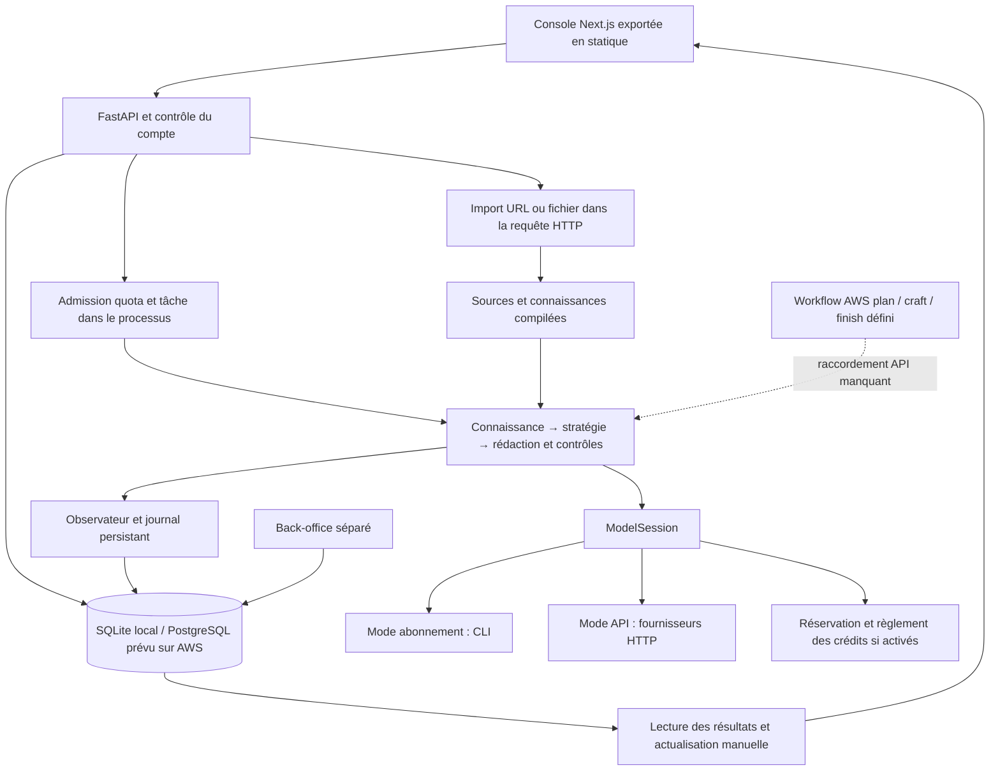

# MarketingOS — audit global avant testeurs et commercialisation

**7 octobre 2026 · État audité : branche `master`, HEAD `6d36612` et modifications locales présentes.**

> **État initial conservé pour traçabilité.** Des corrections ont ensuite été appliquées à la demande de l'utilisateur. Lire [le bilan des corrections et des blocages restants](corrections.md) pour l'état courant et les nouvelles vérifications ; les résultats ci-dessous décrivent la situation avant correction. `preuves.json` conserve cette référence historique et `reproduce_checks.py` vérifie désormais les sondes après correction.

## Décision

**Le socle est sérieux, mais je ne recommande pas encore une ouverture autonome à des testeurs distants, et encore moins une facturation réelle.** Les principaux obstacles sont l'intégration du déploiement, la transparence et la robustesse des crédits, la gestion des incidents, puis quelques parcours essentiels. Une refonte complète du moteur ou de l'identité visuelle serait un mauvais premier investissement.

| Niveau de lancement | Verdict à cette date | Conditions |
| --- | --- | --- |
| Démonstration / séance locale accompagnée | Possible après préparation et vérification du cas choisi | Source ciblée, résultat relu, opérateur présent, aucune promesse de délai ou d'exactitude absolue |
| Pilote privé distant et autonome | **Non validé** | Un hébergement réellement fonctionnel, comptes isolés, parcours complet en navigateur, récupération après panne, assistance joignable |
| Vente avec crédits | **Bloquée dans l'état audité** | Installation reproductible, prévision/plafond de dépense, comptabilité vérifiée, réservations réconciliables, parcours Stripe et conditions commerciales |
| Produit « parfait », pour toutes offres et toutes langues | **Aucune preuve ne permet de l'affirmer** | Définir des usages supportés et des critères de sortie, puis élargir sur la base des résultats |

La cible proposée pour la première version est simple : **un utilisateur fournit ses sources, décrit une campagne email, comprend ce qu'elle coûtera, reçoit des brouillons traçables, les relit et les récupère sans intervention du développeur**. La recherche marché reste secondaire. LinkedIn peut rester hors du périmètre commercial initial, conformément au retrait déjà engagé dans l'interface payante.

Ce rapport contient **des défauts reproduits, des défauts établis par le code, des observations historiques et des améliorations proposées**. Ces catégories sont explicitement séparées. Une absence de preuve en préproduction est une validation à faire, pas la preuve que la fonctionnalité est cassée.

## 1. Ce qui a réellement été vérifié

### Résultats de cette revue

| Vérification | Résultat |
| --- | --- |
| Backend : `pytest tests -q` | **1 419 tests passent**, 125,17 s ; deux avertissements de dépréciation |
| Backend : Ruff `app tests` puis périmètre CI `app tests scripts` | **Propre** |
| Backend : `pip check` dans le venv existant | **Propre** ; cela ne valide pas une installation neuve depuis les locks |
| Backend : `scripts/export_api_types.py --check` | **Échec, code de sortie 1** : schéma généré périmé |
| Migrations : `scripts/check_migrations.py` | **Réussite** : montée, descente, remontée et parité des modèles sur SQLite temporaire |
| Frontend produit : lint, typecheck, tests | **Propres ; 12 tests passent** |
| Frontend produit : build | **Réussite**, export statique de 23 pages |
| Back-office backend : tests et Ruff | **Suite réussie, Ruff propre** |
| Back-office frontend : lint, typecheck, build | **Réussite**, export statique de 8 pages |
| `npm audit --omit=dev`, les deux frontends | **3 paquets signalés dans chaque installation : 1 critique, 2 élevés** ; exposition à qualifier, voir SEC-01 |
| Sondes locales spécifiques à l'audit | Deux suppressions échouent par contrainte FK ; un contournement de configuration payante est accepté ; le payload d'erreur AWS perd l'identifiant attendu |
| Nouvelle inspection du produit dans le navigateur | **Impossible à cette session** : `localhost:3000` refuse la connexion ; aucun service détecté sur les ports locaux documentés |
| Inspection visuelle disponible | Lecture de deux captures historiques du pilote, rapprochées du code actuel ; **pas une certification du rendu actuel** |

Les sondes et leur résultat sont conservés dans [reproduce_checks.py](C:/Users/oussa/Desktop/Workspace/projects/MarketingOS/docs/audits/2026-10-07/reproduce_checks.py) et [preuves.json](C:/Users/oussa/Desktop/Workspace/projects/MarketingOS/docs/audits/2026-10-07/preuves.json). La [recette avant testeurs](C:/Users/oussa/Desktop/Workspace/projects/MarketingOS/docs/audits/2026-10-07/recette-avant-testeurs.md) transforme les constats en scénarios vérifiables.

### Périmètre et limites

Revue transversale du backend, de l'authentification et de l'isolation, de l'ingestion, du moteur de campagne, des providers, des crédits, des écrans produit et admin, de la landing page, des scripts de build et de l'infrastructure. Lecture des derniers dossiers de qualité, y compris la conclusion iFixit du 6 octobre plutôt que seulement le résumé pilote devenu incomplet.

Pas de génération IA, de paiement, d'envoi d'email, de déploiement, d'accès à un compte cloud ou de modification de la base de développement. Les seuls nouveaux fichiers sont les livrables d'audit. Les changements préexistants sont conservés ; aucun commit, changement de branche ou worktree.

La référence `.Codex/launch.json` indiquée dans les instructions n'existe pas ; les configurations locales se trouvent dans `.claude/launch.json`. Aucun outil de lancement preview n'est exposé dans cette session. Une URL de test a été demandée ; l'audit a continué sans attendre. Les parcours authentifiés dans un vrai navigateur, le responsive actuel, PostgreSQL/Aurora, les déploiements AWS, les fournisseurs réels et les clients email restent à vérifier. La revue de sécurité ne constitue pas un pentest exhaustif ; l'audit de dépendances Python n'a pas été réalisé contre une base de vulnérabilités.

## 2. Architecture : conserver le cœur, terminer les raccordements

**À préserver :**

- L'ordre du pipeline est décidé en Python ; les modèles ne pilotent pas la dépense ni les permissions.
- `ModelSession`, le catalogue de modèles et l'émetteur d'événements centralisent des responsabilités importantes.
- Les assertions numériques, citations et liens sont contrôlés ; la lecture à froid est séparée du brief.
- Les sources compilées sont réutilisées par empreinte ; ce mécanisme évite une grosse part des dépenses répétées.
- Les accès aux marques/campagnes sont filtrés par propriétaire ; les tests couvrent plusieurs frontières entre comptes.
- Les protections de lecture web sont déjà substantielles : adresses privées refusées, DNS fixé, redirections recontrôlées, taille et durée bornées.
- Le rendu HTML est déterministe et la prévisualisation utilise un iframe sandboxé. Il n'y a pas besoin d'ajouter un modèle pour le design.
- L'authentification distingue les jetons client et administrateur ; le renouvellement et la révocation globale sont testés.
- La suite de tests est importante et fonctionne sans consommer du quota IA.

**Choix recommandé pour le pilote distant :** une seule instance persistante de l'API, HTTPS et même origine pour console/API, avec une base sauvegardée et un mode de facturation choisi explicitement. En mode API, terminer l'injection des clés et la préparation des dépendances ; en mode abonnement, traiter explicitement l'authentification et la disponibilité des CLI. L'instance unique correspond aux invariants actuels ; ne pas activer plusieurs workers.

Le dossier AWS contient une autre voie, à base de Step Functions. Elle est incomplète. Il faut soit la terminer et la qualifier comme une vraie architecture de production, soit l'écarter de la première livraison et documenter la voie persistante. **Ne pas assembler une API Lambda, un registre en mémoire ailleurs et des routes réparties au hasard.**

## 3. Installation, backend et exécution

Priorités : **P0** bloque le lancement indiqué ; **P1** à régler avant le pilote autonome ou avant activation de la fonction concernée ; **P2** amélioration utile après sécurisation du parcours. Les estimations sont des tailles de travail, validation incluse : **S** ≈ moins d'un jour ; **M** ≈ 1–3 jours ; **L** ≈ 3–7 jours ; **XL** à découper. Ce sont des ordres de grandeur, pas des engagements ni des durées à additionner mécaniquement.

### BE-01 — Dépendances de déploiement incomplètes

**P0 · toute installation propre · Confirmé par inspection et sonde · S**

Stripe est déclaré dans `pyproject.toml`, importé sans condition par le routeur crédits, mais absent de `requirements.txt` et `requirements.lock`. Le routeur est chargé même lorsque la facturation est désactivée. CodeBuild installe le lock puis le projet avec `--no-deps` ; le conteneur installe `requirements.txt`. Un environnement local possédant déjà Stripe masque donc une erreur d'import attendue dans un environnement neuf.

**Faire :** régénérer les deux fichiers verrouillés, les vérifier dans un environnement vierge, puis importer l'application avec billing désactivé et activé. Vérifier aussi l'image worker : elle installe les dépendances API et les binaires CLI, mais pas l'extra Python `claude-agent-sdk` requis par `ClaudeProvider` en mode abonnement.

**Terminé quand :** installation exacte CI/image, `pip check`, import de l'app et création des providers compatibles avec le mode choisi réussissent sans package ajouté manuellement. Sources : [pyproject.toml:27](C:/Users/oussa/Desktop/Workspace/projects/MarketingOS/backend/pyproject.toml:27), [buildspec.yml:62](C:/Users/oussa/Desktop/Workspace/projects/MarketingOS/backend/buildspec.yml:62), [Dockerfile:28](C:/Users/oussa/Desktop/Workspace/projects/MarketingOS/backend/Dockerfile:28), [credits.py:5](C:/Users/oussa/Desktop/Workspace/projects/MarketingOS/backend/app/api/routes/credits.py:5).

### BE-02 — Contrat API généré périmé

**P0 · livraison par la CI prévue · Reproduit · S**

`export_api_types.py --check` échoue alors que TypeScript passe. Le frontend compare une partie de ses types à un ancien schéma, pas au backend actuel. La CI contient bien ce garde-fou : c'est sa vérification locale qui manquait au simple trio lint/tests/build.

**Faire :** régénérer le schéma après stabilisation des changements en cours, réconcilier les types, étendre les assertions aux réponses crédits, exécutions et marché utilisées. **Terminé quand :** le check du générateur et TypeScript passent dans la même révision. Sources : [export_api_types.py:38](C:/Users/oussa/Desktop/Workspace/projects/MarketingOS/backend/scripts/export_api_types.py:38), [api-contracts.ts](C:/Users/oussa/Desktop/Workspace/projects/MarketingOS/frontend/src/lib/api-contracts.ts).

### BE-03 — Le lancement utilisateur n'atteint pas Step Functions

**P0 · voie AWS Lambda actuelle · Confirmé par code · L ou exclusion de cette voie**

`start_execution()` appelle toujours `execution_manager.launch()`. Ce dernier réserve puis lance une tâche dans le processus. La réservation refuse Lambda hors `JOB_HOST`. L'API Lambda n'a ni ce flag, ni dispatch vers la state machine, ni permission `states:StartExecution`. Le workflow existe dans le template sans être relié au bouton. La distribution frontend cible cette API Gateway.

**Faire :** choisir la voie persistante complète pour le pilote, ou ajouter une admission durable, le dispatch, l'identifiant AWS, le suivi et l'annulation. **Terminé quand :** depuis le domaine de test, une création puis un lancement rendent un identifiant, exécutent réellement le travail et retrouvent le résultat après fermeture du navigateur. Sources : [campaign_service.py:489](C:/Users/oussa/Desktop/Workspace/projects/MarketingOS/backend/app/services/campaign_service.py:489), [execution_manager.py:19](C:/Users/oussa/Desktop/Workspace/projects/MarketingOS/backend/app/orchestration/execution_manager.py:19), [work_limits.py:32](C:/Users/oussa/Desktop/Workspace/projects/MarketingOS/backend/app/runtime/work_limits.py:32), [backend/template.yaml](C:/Users/oussa/Desktop/Workspace/projects/MarketingOS/backend/template.yaml), [frontend/template.yaml](C:/Users/oussa/Desktop/Workspace/projects/MarketingOS/frontend/template.yaml).

### BE-04 — Le chemin d'erreur AWS ne peut pas sauver les emails

**P0 si Step Functions est retenu · Code + reproduction du payload · M**

Le `Catch` de `CraftEmail` mène à `Finish` sans `ResultPath`. Dans cette configuration, l'erreur remplace l'entrée : `execution_id` disparaît. Le handler suivant le réclame et échoue avec `The event carries no execution_id.`. Les états `Failed` ne finalisent pas le statut métier en base. Le commentaire promettant de préserver les emails ne suffit donc pas.

**Faire :** conserver l'entrée, enregistrer la raison d'arrêt, finaliser les données et rendre les livrables déjà acceptés même si un step échoue. Traiter aussi l'échec du plan et de la conclusion. **Terminé quand :** panne injectée au deuxième email → statut terminal, premier email récupérable, erreur lisible et coût cohérent. Sources : [template.yaml:445](C:/Users/oussa/Desktop/Workspace/projects/MarketingOS/backend/template.yaml:445), [step_handlers.py:45](C:/Users/oussa/Desktop/Workspace/projects/MarketingOS/backend/step_handlers.py:45). Le remplacement de l'entrée est documenté par [AWS ResultPath](https://docs.aws.amazon.com/step-functions/latest/dg/input-output-resultpath.html).

### BE-05 — La voie par étapes perd des garanties du runner normal

**P0 si Step Functions est retenu · Confirmé par code · L**

Le pipeline reconstruit utilise `deadline=None` et `cancel_token=None`. Le compteur de tokens et les réservations sont recréés par invocation ; il n'y a pas de budget global durable équivalent. La concurrence est comptée dans un dictionnaire local, ce qui ne limite pas plusieurs instances Lambda. `plan()` remet les emails et le curseur à zéro ; `finish()` n'a pas de garde terminale empêchant de relancer sa revue et sa persistance. `rebuild_context()` est appelé hors réservation dans craft/finish et peut recompiler si les sources ont changé. La récupération de matériel est volontairement absente de ce chemin.

**Faire :** état durable comprenant budget restant, annulation, admission, version des sources et états terminaux ; opérations protégées par clé de step/version et transaction ; tests de rejouabilité et de parité. **Terminé quand :** rejouer plan/finish ne réécrit ni ne refacture, annuler stoppe les appels suivants, le cumul de plusieurs steps respecte l'enveloppe initiale et le contexte reste stable. Sources : [stepped_runner.py:162](C:/Users/oussa/Desktop/Workspace/projects/MarketingOS/backend/app/orchestration/stepped_runner.py:162), [campaign_orchestrator.py:1199](C:/Users/oussa/Desktop/Workspace/projects/MarketingOS/backend/app/orchestration/campaign_orchestrator.py:1199), [work_limits.py:28](C:/Users/oussa/Desktop/Workspace/projects/MarketingOS/backend/app/runtime/work_limits.py:28).

### BE-06 — Infrastructure et configuration ne forment pas encore une livraison unique

**P0 · hébergement choisi · Confirmé dans les templates ; déploiement non exécuté · M/L**

Les steps Lambda utilisent des API externes mais la VPC de référence est décrite sans NAT. Un accès à Aurora n'implique pas un accès aux fournisseurs. Les templates ne raccordent pas les nouveaux paramètres Stripe/crédits. Le worker historique utilise Secrets Manager, tandis que le runbook principal provisionne SSM ; ses credentials CLI résident dans un volume qui ne survit pas au remplacement d'une task. L'URL HTTPS de sortie basée sur le nom DNS de l'ALB ne remplace pas la configuration d'un domaine correspondant au certificat.

**Faire :** un manifeste de déploiement cohérent : API cible, réseau sortant, secrets, mode IA, billing, domaine et cookies. **Terminé quand :** démarrage à froid puis remplacement de l'instance passent le même smoke test, sans authentification ou installation manuelle imprévue. Sources : [iac/worker.yaml](C:/Users/oussa/Desktop/Workspace/projects/MarketingOS/iac/worker.yaml), [iac/README.md](C:/Users/oussa/Desktop/Workspace/projects/MarketingOS/iac/README.md), [backend/template.yaml](C:/Users/oussa/Desktop/Workspace/projects/MarketingOS/backend/template.yaml). Voir [accès Internet des Lambda en VPC](https://docs.aws.amazon.com/lambda/latest/dg/configuration-vpc-internet.html).

### BE-07 — Arrêt brutal : les livrables acceptés ne sont pas des checkpoints

**P1 · pilote autonome · Confirmé par code · M/L**

Le runner persistant sauve les assets finaux après `pipeline.run()`. Les événements et brouillons intermédiaires peuvent être en base, mais le crash handler et le reaper de démarrage ne les transforment pas en livrables récupérables. Les arrêts coopératifs bien traités ne couvrent pas une coupure de processus ou un déploiement.

**Faire :** persister une version acceptée par position, distincte de la version finale, avec provenance et validation ; reconstruire un résultat partiel explicite au redémarrage. Ajouter un mode de maintenance qui refuse les nouveaux jobs avant déploiement. **Terminé quand :** arrêt forcé après email 1 → cet email reste récupérable sans rejouer tout le budget ; aucun brouillon bloqué n'est présenté comme validé. Sources : [campaign_orchestrator.py:880](C:/Users/oussa/Desktop/Workspace/projects/MarketingOS/backend/app/orchestration/campaign_orchestrator.py:880), [campaign_orchestrator.py:914](C:/Users/oussa/Desktop/Workspace/projects/MarketingOS/backend/app/orchestration/campaign_orchestrator.py:914), [execution_manager.py](C:/Users/oussa/Desktop/Workspace/projects/MarketingOS/backend/app/orchestration/execution_manager.py).

### BE-08 — Imports longs et imports vides mal matérialisés

**P1 · pilote autonome · Confirmé par code · M**

L'import d'un site complet est attendu dans la requête HTTP. Le crawler peut lire la racine puis plusieurs vagues de pages, chacune bornée mais dont la somme peut dépasser le timeout de la passerelle. Une page JavaScript ou trop courte peut produire une liste vide sans erreur ; la route retourne alors une réussite et l'UI affiche « Knowledge added ». Les échecs des pages secondaires sont loggés, pas détaillés à l'utilisateur.

**Faire :** job d'import avec progression, résultat par URL, reprise et état « aucune information lisible » ; aperçu des pages choisies et mode page unique. **Terminé quand :** site lent, site JS, page vide et import partiel produisent chacun un résultat explicite ; aucun toast de réussite sans source enregistrée. Sources : [knowledge.py:105](C:/Users/oussa/Desktop/Workspace/projects/MarketingOS/backend/app/api/routes/knowledge.py:105), [site_crawler.py:58](C:/Users/oussa/Desktop/Workspace/projects/MarketingOS/backend/app/ingestion/loaders/site_crawler.py:58), [add-knowledge-dialog.tsx:70](C:/Users/oussa/Desktop/Workspace/projects/MarketingOS/frontend/src/app/knowledge/add-knowledge-dialog.tsx:70).

### BE-09 — Les limites d'upload doivent être celles du chemin déployé

**P1 · pilote distant · Écart de configuration confirmé, trajet réel à tester · M**

L'API accepte théoriquement 20 Mo, après parsing multipart. Une requête passant par Lambda rencontre une limite de payload synchrone inférieure, avec une enveloppe et éventuellement de la base64. Dans la voie persistante, la limite appliquée après réception ne protège pas à elle seule le volume transféré ou le spool disque. Les champs texte/brief n'ont pas tous de plafond de taille.

**Faire :** limite à l'entrée et dans l'UI cohérente avec l'hôte ; si 20 Mo doivent être supportés sur la voie Lambda, upload direct vers stockage privé puis extraction contrôlée ; borner les champs et l'espace par compte. **Terminé quand :** juste sous/au-dessus des limites, type invalide, PDF chiffré et document volumineux répondent proprement sans saturer le service. Sources : [knowledge.py:20](C:/Users/oussa/Desktop/Workspace/projects/MarketingOS/backend/app/api/routes/knowledge.py:20), [document_worker.py](C:/Users/oussa/Desktop/Workspace/projects/MarketingOS/backend/app/ingestion/document_worker.py), [schemas/knowledge.py](C:/Users/oussa/Desktop/Workspace/projects/MarketingOS/backend/app/schemas/knowledge.py). Référence : [quotas de payload Lambda](https://docs.aws.amazon.com/lambda/latest/dg/gettingstarted-limits.html).

### BE-10 — Deux suppressions échouent avec les nouvelles relations SQL

**P1 · fonctions concernées · Reproduit sur SQLite avec FK activées · M**

`delete_campaign()` supprime les exécutions sans supprimer `CampaignRunState`. `admin.service.delete_user()` supprime l'utilisateur sans traiter les nouvelles tables de crédits. Les deux sondes échouent avec `FOREIGN KEY constraint failed`. La seconde ne nécessite même qu'un compte de crédits, sans achat Stripe réel.

**Faire :** définir explicitement la suppression des données opérationnelles et la conservation/anonymisation du journal financier ; réaliser les mutations dans une transaction ; couvrir SQLite avec contraintes et PostgreSQL. Ne pas supprimer aveuglément l'historique de paiement pour faire passer le test. **Terminé quand :** supprimer une campagne avec état de run fonctionne ; clôturer un compte crédité a un comportement défini, sans 500 ni données orphelines. Sources : [campaign_service.py:160](C:/Users/oussa/Desktop/Workspace/projects/MarketingOS/backend/app/services/campaign_service.py:160), [admin/service.py:417](C:/Users/oussa/Desktop/Workspace/projects/MarketingOS/administration/backend/admin/service.py:417), [credit.py](C:/Users/oussa/Desktop/Workspace/projects/MarketingOS/backend/app/models/credit.py).

### BE-11 — Historique des compilations et recherches en mémoire

**P1 · pilote autonome · Confirmé · M**

Les résultats métiers persistent, mais les jobs compilation/marché et leurs messages vivent dans des dictionnaires. Après redémarrage, le statut peut revenir à idle ou disparaître sans reçu d'interruption. Ils n'ont pas tous un parcours d'annulation comparable aux campagnes.

**Faire :** journal minimal durable de job : propriétaire, type, source/version, état, début/fin, erreur, consommation et demande d'annulation. Pas besoin d'un système distribué complet pour cela. **Terminé quand :** rouvrir Runs après redémarrage explique chaque job et permet une relance explicite. Sources : [knowledge_compilation.py:64](C:/Users/oussa/Desktop/Workspace/projects/MarketingOS/backend/app/services/knowledge_compilation.py:64), [market_service.py](C:/Users/oussa/Desktop/Workspace/projects/MarketingOS/backend/app/services/market_service.py).

## 4. Crédits, paiement et rentabilité

Le socle comptable possède déjà des protections utiles : montants choisis sur le serveur, webhook signé, attribution idempotente d'un paiement, débit conditionnel, refus des soldes insuffisants et séparation test/live. Il faut terminer les parcours et les invariants autour de ces fonctions.

| ID / priorité / effort | Constat et conséquence | Modification et critère de fin |
| --- | --- | --- |
| **PAY-01 · P0 avant paiement · M** | L'écran promet de consulter l'estimation, mais `RunForecast` n'affiche que le nombre d'emails et la réutilisation des sources. Le lanceur n'impose pas de plafond en crédits choisi par le client. | Afficher solde, estimation si disponible, montant maximal autorisé et coût de préparation. Bloquer proprement si insuffisant ; plafond durable pour tout le run. Acceptation : aucun chemin Start/Restart/Answers ne dépense au-delà de l'autorisation affichée. |
| **PAY-02 · P1 avant paiement · M** | Les réserves sont difficiles à comprendre et parfois supérieures aux packs proposés. Avec les constantes actuelles, un appel Sonnet avec recherche et 4 096 tokens de sortie réserve **1 283 crédits** ; le pack de 1 000 ne suffit pas même avant l'usage réel. Opus équivalent : **6 372**, au-dessus du pack de 6 000. Ce sont des calculs du code, pas des prix fournisseurs certifiés. | Préflight du montant nécessaire et explication de la différence réservé/consommé/disponible ; calibrer les bornes à partir des capacités réellement utilisées. Ne pas diminuer une réserve au prix d'un débit non maîtrisé. Acceptation : le client sait avant achat quelle opération le pack permet. |
| **PAY-03 · P1 avant paiement · M** | Une réserve est prise avant `_send()`, puis `permit.attempt()` peut refuser avant tout appel fournisseur. Dans ce cas certain de non-envoi, la réserve reste retenue comme une erreur réseau ambiguë. La reprise/restitution après crash n'a pas de parcours opérateur dédié. | États explicites reserved/sent/settled/uncertain/released ; libérer automatiquement uniquement les non-envois prouvés ; réconciliation manuelle auditée pour les cas incertains. Acceptation : budget déjà atteint → zéro débit net et zéro appel ; timeout ambigu → reçu explicite, pas de double appel. |
| **PAY-04 · P0 avant paiement · M** | `usage_cost_usd()` utilise un tarif de repli Sonnet pour un modèle non reconnu ; la même table contient des estimations historiques et des tarifs présentés comme revus. Les taux de cache sont globaux. Le modèle retourné par un fournisseur peut différer du slug demandé. | Séparer estimation opérateur et tarification client ; catalogue par fournisseur/version/mode, alias canonique, règles de cache/outils et traitement des usages absents. Vérifier les tarifs et la disponibilité API réels avant activation, sans déduire la compatibilité d'un succès CLI. Acceptation : modèle/rate inconnu refuse le règlement automatique ; fixture chiffrée indépendante par modèle. |
| **PAY-05 · P1 avant paiement · S/M** | **Reproduit :** le routeur refuse `model_overrides` direct, mais accepte `overrides.model_overrides`. On peut sauvegarder un modèle que le service prétend gérer lui-même ; un modèle non tarifé peut faire échouer le run. | Valider la politique effective, pas seulement le champ externe ; whitelist serveur des réglages client en mode payant. Même contrôle sur anciens briefs, duplication et relance. Acceptation : mêmes règles pour tous les chemins et aucune dépense si politique refusée. |
| **PAY-06 · P0 avant paiement · M/L** | Tests Stripe simulés présents ; pas de preuve dans cette revue d'un achat, webhook, retour navigateur et consommation sur l'hôte final. Le template ne provisionne pas encore l'activation. | Recette Stripe test : paiement immédiat/différé, webhook répété et désordonné, signature invalide, panne de DB, remboursement et litige. Idempotence aussi de la création de checkout et rapprochement des sessions orphelines. Acceptation : exactement une attribution et un reçu retrouvé après rechargement ; aucun achat live pour tester à l'aveugle. |
| **PAY-07 · P1 avant paiement · M** | Le panneau masque ses erreurs, disparaît si la lecture échoue, montre cinq mouvements sans référence à la campagne ; il vérifie le retour pendant seulement dix intervalles. Un paiement différé ou une réserve retenue n'a pas de suivi compréhensible. | États chargement/indisponible/paiement en attente/crédité/annulé, bouton Actualiser, historique daté lié au run, aide support et exports de reçus. Le retour navigateur ne doit jamais créditer lui-même. Acceptation : webhook retardé au-delà de 20 s ne ressemble pas à de l'argent perdu. |
| **PAY-08 · P1 avant paiement · M** | Crédits et quota mensuel de jobs coexistent. Import d'image, compilation et recherche peuvent consommer un quota ; acheter des crédits n'augmente pas ce quota. Le menu parle encore de plans/runs. | Définir une seule explication commerciale des limites : crédits, simultanéité et éventuel plafond d'usage. Afficher pourquoi une opération est bloquée et éviter « recharge » si la cause est un quota distinct. Acceptation : solde positif + quota épuisé donne la bonne action, sans vente inutile. |
| **PAY-09 · P2 exploitation payante · S** | Plus de 30 jours après la date de revue tarifaire, `get_settings()` refuse de démarrer en mode prépayé. Ce verrou de sécurité peut empêcher aussi l'accès aux comptes et aux webhooks après redémarrage. | Alerte anticipée et procédure de révision ; fermer l'admission de nouveaux appels tout en gardant lecture, support et rapprochement disponibles. Acceptation : date expirée testée avec horloge simulée ; pas de paiement encaissé dans un service devenu inaccessible. |

Sources : [run-forecast.tsx](C:/Users/oussa/Desktop/Workspace/projects/MarketingOS/frontend/src/components/run-forecast.tsx), [run-launcher.tsx](C:/Users/oussa/Desktop/Workspace/projects/MarketingOS/frontend/src/components/run-launcher.tsx), [credit_meter.py:86](C:/Users/oussa/Desktop/Workspace/projects/MarketingOS/backend/app/services/credit_meter.py:86), [model_session.py:418](C:/Users/oussa/Desktop/Workspace/projects/MarketingOS/backend/app/runtime/model_session.py:418), [models.py:244](C:/Users/oussa/Desktop/Workspace/projects/MarketingOS/backend/app/ai/models.py:244), [campaigns.py](C:/Users/oussa/Desktop/Workspace/projects/MarketingOS/backend/app/api/routes/campaigns.py), [credit-panel.tsx](C:/Users/oussa/Desktop/Workspace/projects/MarketingOS/frontend/src/app/settings/credit-panel.tsx), [work_limits.py](C:/Users/oussa/Desktop/Workspace/projects/MarketingOS/backend/app/runtime/work_limits.py), [config.py:18](C:/Users/oussa/Desktop/Workspace/projects/MarketingOS/backend/app/core/config.py:18).

Stripe documente les signatures, les doublons, les réessais et l'absence de garantie d'ordre des événements : [documentation webhooks](https://docs.stripe.com/webhooks). Les tests locaux couvrent déjà une partie des doublons et inversions ; l'action restante est le raccordement et la recette complète, pas la réécriture inutile de ce qui fonctionne.

**Rentabilité :** le cas iFixit complet archivé rapporte une estimation opérateur de **31,3811 $ pour trois emails et 23 min 32 s**, sous une enveloppe étendue et avec un corpus enrichi. Il ne faut ni le transformer en facture ni extrapoler son coût à tous les clients. Il démontre toutefois qu'un multiplicateur de 2 ne remplace pas un contrôle du coût total, des reprises, du support et des frais. Pour le pilote, limiter le nombre d'emails et les sources admises, annoncer le plafond et mesurer le coût du résultat effectivement utilisable.

## 5. Sécurité, données et comptes

| ID / priorité / effort | Observation établie | Travail demandé et validation |
| --- | --- | --- |
| **SEC-01 · P1 · S/M** | Audit npm : `next` critique, `sharp` élevé, `source-map-js` élevé, dans les deux frontends. Next est en 16.3.5 ; l'avis mainteneur corrige la vulnérabilité `next/og` en 16.3.6. Aucun usage `ImageResponse`/`next/og` trouvé dans les sources inspectées, et les consoles sont exportées statiquement. **Pas de preuve d'exploitation ni de RCE exposée dans le site statique.** | Mettre à jour les dépendances corrigées et locks, garder Next/eslint alignés, rebuild et recette des routes statiques. Vérifier les usages transitifs et outils de build ; ne pas utiliser `npm audit fix --force` aveuglément. Fin : alertes éliminées ou exception documentée avec analyse d'exposition. |
| **SEC-02 · P1 avant accès distant · M** | Pas de limitation applicative de tentatives de connexion identifiée ; le throttle global API Gateway n'est pas une protection par identité. Le worker peut être exposé hors Gateway. | Limitation partagée par IP/compte, temporisation graduelle, erreurs non énumérantes, limitation des endpoints coûteux. Fin : attaque simulée sur compte jetable ralentie sans bloquer tous les utilisateurs. |
| **SEC-03 · P1 avant accès distant · S/M** | Le client dépend de cookies de même origine, alors que le profil de démo utilise frontend :3010/API :8010. Les appels auth utilisent `credentials: same-origin` : les cookies de l'API ne constituent pas une session utilisable dans ce trajet cross-origin. | Préférer un proxy local et distant sous `/api`, puis tester auth avec l'origine réelle. À défaut, configurer intentionnellement credentials/CORS/cookies de tous les appels concernés. Fin : login, refresh, CSV et logout fonctionnent sur le profil documenté. |
| **SEC-04 · P1 · S/M** | Logout ignore erreurs réseau et statuts HTTP, puis redirige ; le cookie d'accès peut rester, et le guard de login renvoyer vers le produit. Le logout simple révoque le refresh mais n'invalide pas immédiatement un bearer d'accès déjà copié ; la révocation globale, elle, utilise `token_version`. | Traiter la réponse du logout et documenter la sémantique de révocation ; nettoyage local explicite, état d'échec et stratégie serveur par session si déconnexion immédiate promise. Fin : panne réseau à la déconnexion et réutilisation d'un ancien jeton testées. |
| **SEC-05 · P1 avant accès distant · M** | Le cookie d'accès est lisible par JavaScript par choix d'architecture. Le template de la console produit n'attache pas de politique de headers comparable à celle du back-office ; aucune CSP produit identifiée. | Définir headers de sécurité et CSP compatibles avec Next statique et `srcDoc`, cadrage, contenu et connexions autorisés ; tester en report-only avant enforcement. Ne pas simplement rendre le cookie httpOnly sans adapter le transport des mutations. Fin : vérifier les headers sur le domaine réellement livré et les liens/aperçus malveillants en données de test. |
| **SEC-06 · P1 avant données réelles · M/L** | Pas de parcours complet visible pour export/effacement de compte et workspace. La suppression admin enlève l'owner mais conserve le travail ; supprimer une marque contenant des dépendances est refusé sans parcours global de nettoyage. Les sources et journaux peuvent contenir des informations client. | Définir inventaire des données, durées, destinataires IA, accès support, export et suppression/anonymisation. Ajouter une notice avant import et un point de contact. Fin : exercice sur compte jetable couvrant documents, dérivés, exécutions, logs et sauvegardes, avec conservation financière explicitement séparée. |
| **SEC-07 · P2, P1 si back-office exposé largement · M** | Le back-office a des rôles et une piste d'audit, mais ne propose pas de console de réconciliation crédits ; la suite admin utilise une base fichier sans l'activation explicite des FK du fixture API produit. | Activer les mêmes contraintes dans les tests admin, tester autorisations sur chaque action financière et protéger l'accès opérateur (MFA/SSO ou contrôle d'accès d'infrastructure adapté). Fin : un support ne peut ni s'élever ni ajuster des crédits sans permission et trace. |

Sources : [avis du mainteneur Next.js](https://github.com/vercel/next.js/security/advisories/GHSA-vcvr-r3jv-pc5j), résultats npm enregistrés dans les preuves, [auth-form.tsx:40](C:/Users/oussa/Desktop/Workspace/projects/MarketingOS/frontend/src/components/auth-form.tsx:40), [renew-session.ts](C:/Users/oussa/Desktop/Workspace/projects/MarketingOS/frontend/src/lib/renew-session.ts), [account-menu.tsx:44](C:/Users/oussa/Desktop/Workspace/projects/MarketingOS/frontend/src/components/layout/account-menu.tsx:44), [auth/service.py:195](C:/Users/oussa/Desktop/Workspace/projects/MarketingOS/backend/app/auth/service.py:195), [auth/dependencies.py](C:/Users/oussa/Desktop/Workspace/projects/MarketingOS/backend/app/auth/dependencies.py), [admin/tests/conftest.py](C:/Users/oussa/Desktop/Workspace/projects/MarketingOS/administration/backend/tests/conftest.py).

Les notices et contrats devront correspondre aux marchés et clients retenus. Pour une offre concernée par le RGPD, la CNIL détaille l'information sur les finalités, destinataires et conservation ainsi que l'encadrement des sous-traitants : [information des personnes](https://www.cnil.fr/fr/informer-les-personnes), [qualification de sous-traitant](https://www.cnil.fr/fr/qualification-juridique-sous-traitance). Ce rapport constate les parcours manquants ; il ne certifie pas la conformité juridique de l'offre.

## 6. UI et UX : rendre le parcours autonome

### Direction visuelle

L'identité sombre/violette, les panneaux, la typographie et les variantes de statut forment une base cohérente. Les captures historiques montrent une interface déjà utilisable, pas un prototype visuel à jeter. Le problème prioritaire est la hiérarchie des décisions et la véracité de l'information, plus que la décoration.

Deux captures ont été relues : [formulaire mobile historique](C:/Users/oussa/Desktop/Workspace/projects/MarketingOS/docs/optimization/pilot-readiness/screenshots/custom-campaign-mobile.jpg) et [résultat iFixit mobile historique](C:/Users/oussa/Desktop/Workspace/projects/MarketingOS/docs/optimization/pilot-readiness/screenshots/ifixit-completed-mobile.jpg). La première montre encore LinkedIn et quatre boutons ; le code courant a trois boutons. La seconde montre prix et étapes, qui ont depuis été masqués dans certains écrans. **Ces captures servent de contexte ; aucune conclusion pixel près sur l'interface actuelle ne leur est attribuée.**

| ID / priorité / effort | Problème ou amélioration | Action concrète et critère de fin |
| --- | --- | --- |
| **UX-01 · P1 · M** | Le nouveau brief rassemble de nombreuses questions, puis demande le type de livrable via plusieurs boutons finaux. Le champ libre est annoncé optionnel alors qu'il est obligatoire pour Custom emails. Le commentaire du composant reconnaît seize questions. | Choisir d'abord le type, puis 3–4 questions indispensables : sources/offre, public, objectif, nombre/langue. Mettre expéditeur, design et réglages dans des options. Un seul bouton « Enregistrer le brief ». Fin : utilisateur neuf sait quoi remplir et sait qu'enregistrer ne lance pas de génération. |
| **UX-02 · P1 · M** | L'API expose création et modification de politique, pas de modification générale du brief. Une faute de CTA, de nom ou de public oblige à recréer ; la marque n'a pas de parcours complet de renommage/site. | Édition des champs métier avant run et création d'une nouvelle version de brief après run, en préservant l'historique. Fin : corriger une URL/public ne nécessite pas de ressaisir les sources ; les anciens résultats gardent leur contexte. |
| **UX-03 · P1 · S/M** | Le formulaire vit en mémoire. « Manage knowledge base » quitte vers `/knowledge` même dans un contexte marque et peut faire perdre le brief. `reset()` ne réinitialise pas `goals`, contrairement aux autres champs. | Brouillon récupérable, navigation vers les bonnes sources, contrôle des fermetures pendant import, reset exhaustif. Fin : fermeture/réouverture, changement de marque et deuxième campagne n'héritent pas silencieusement d'objectifs antérieurs. |
| **UX-04 · P1 · M** | Beaucoup de `catch` transforment une panne en absence de données : erreur de marque → page inexistante ; échec sources → zéro source ; échec Settings/me → « single workspace » ; échec de compilation connue → forcer la recompilation. | Distinguer 404 attendu, 401/403, erreur réseau et 5xx ; état d'erreur local et retry, sans nouveau coût implicite. Fin : tests de panne montrent « indisponible », jamais « vous n'avez aucune donnée » ou un mode de compte faux. |
| **UX-05 · P1 · S/M** | Le suivi utilise un snapshot manuel. Des liens disent Watch/follow as it writes, mais une tâche terminée reste visuellement active jusqu'au refresh. | Soit assumer clairement le suivi manuel avec dernière mise à jour, soit actualiser seulement les jobs actifs et l'onglet visible, avec temporisation et arrêt au statut terminal. La seconde option ajoute des lectures HTTP, aucun appel IA. Fin : complétion/erreur deviennent visibles sans ambiguïté, pas de polling à vide. |
| **UX-06 · P1 · S** | `AnswerQuestionsCard` affirme toujours « Nothing was spent on this run » alors que la compilation précède le préflight ; l'écran d'erreur assure « Nothing has been lost » sans pouvoir le prouver. | Messages issus de la consommation/du statut réel : « aucun brouillon généré », coût réellement engagé, données enregistrées connues, prochaine action. Fin : aucun message générique ne garantit coût nul ou absence de perte dans tous les cas. |
| **UX-07 · P1 · S/M** | Import raté après création : simple toast contenant le nom des fichiers/URL ; le brief est malgré tout annoncé sauvegardé puis la page change. Pas de réparation persistante attachée au brief. | Reçu d'import affiché sur la campagne, motifs lisibles par fichier, actions réessayer/remplacer et état source manquante avant lancement. Fin : fermer puis rouvrir ne fait pas disparaître le problème. |
| **UX-08 · P2, contrôle mobile P1 · M** | Petits textes 10–11 px, nav horizontale mobile, plusieurs panneaux et détails imbriqués. Certains boutons/dialogues sont déjà soignés ; une refonte globale n'est pas justifiée par les preuves. | Conserver les tokens visuels ; porter les informations essentielles à une taille lisible, hiérarchiser les CTA, réduire les encadrés redondants, rendre la destination active visible au clavier et au tactile. Fin : recette 360/390/768/1440 px, zoom 200 %, noms longs, clavier mobile, sans information essentielle tronquée. |
| **UX-09 · P1 validation, corrections selon résultat · M** | Labels, aria-current, skip link et réduction de mouvement existent. Pas de preuve actuelle d'une recette clavier/lecteur d'écran ni d'un audit de contraste complet. | Parcours clavier, focus modal et retour au déclencheur, erreurs reliées aux champs, statut de traitement annoncé, contraste et zones tactiles. Fin : aucun défaut bloquant sur créer/importer/lancer/lire/copier ; ne pas annoncer une conformité sur la seule base des classes CSS. |
| **UX-10 · P1 si public francophone · M** | Interface et templates largement anglais ; `lang=en`. La langue du message LinkedIn existe, mais la création email ne présente pas de champ de langue équivalent. | Choisir explicitement la langue du pilote ; ajouter langue/région pour la copie email et traduire le parcours essentiel si les testeurs sont francophones. Fin : brief français, résultat, dates, nombres et erreurs cohérents ; ne pas laisser le ton anglais imposer implicitement la langue. |
| **UX-11 · P2, P1 pour usage quotidien · M** | Les emails sont copiables par objet, preview, corps ou HTML ; il manque une édition sauvegardée de la version que le client a réellement retenue et un export groupé simple. | Ajouter version humaine avec original conservé, puis export texte/HTML groupé et avertissement de revalidation après modification factuelle. Fin : retouche retrouvée au rechargement, copie/export identiques, ni promesse automatique de validation de la version éditée ni nouvelle génération obligatoire. |

Sources : [new-campaign-dialog.tsx](C:/Users/oussa/Desktop/Workspace/projects/MarketingOS/frontend/src/app/campaigns/new-campaign-dialog.tsx), [schemas/campaign.py](C:/Users/oussa/Desktop/Workspace/projects/MarketingOS/backend/app/schemas/campaign.py), [brand-layout-view.tsx](C:/Users/oussa/Desktop/Workspace/projects/MarketingOS/frontend/src/app/brands/[brandId]/brand-layout-view.tsx), [settings-view.tsx](C:/Users/oussa/Desktop/Workspace/projects/MarketingOS/frontend/src/app/settings/settings-view.tsx), [use-execution-stream.ts](C:/Users/oussa/Desktop/Workspace/projects/MarketingOS/frontend/src/hooks/use-execution-stream.ts), [answer-questions-card.tsx:103](C:/Users/oussa/Desktop/Workspace/projects/MarketingOS/frontend/src/components/answer-questions-card.tsx:103), [error.tsx](C:/Users/oussa/Desktop/Workspace/projects/MarketingOS/frontend/src/app/error.tsx), [asset-card.tsx](C:/Users/oussa/Desktop/Workspace/projects/MarketingOS/frontend/src/components/asset-card.tsx), [globals.css](C:/Users/oussa/Desktop/Workspace/projects/MarketingOS/frontend/src/app/globals.css).

Pour la recette d'accessibilité, prendre WCAG 2.2 AA comme référence de travail : contraste du texte normal 4,5:1, et cibles minimales selon les conditions/exceptions du critère 2.5.8 ; viser environ 44 px pour les actions tactiles principales est une préférence ergonomique plus confortable, pas la valeur universelle du critère AA. Références : [contraste W3C](https://www.w3.org/WAI/WCAG21/Understanding/contrast-minimum.html), [taille des cibles W3C](https://www.w3.org/WAI/WCAG22/Understanding/target-size-minimum.html).

### Parcours cible à faire valider

1. Invitation et connexion avec un moyen clair de récupérer l'accès.
2. « Créer ma première campagne » ; marque créée ou choisie sans aller-retour obligé.
3. Import, aperçu des sources réellement lues et correction des échecs.
4. Offre, lecteur, action, nombre d'emails et langue ; options secondaires repliées.
5. Résumé modifiable : sources, promesse, destination, coût/plafond et durée indicative honnête.
6. Génération : phase lisible, dernier progrès reçu, possibilité de quitter la page et d'arrêter.
7. Résultat : quantité livrée, éléments à relire, faits sourcés, texte/design, copie et export.
8. Retouche ou correction de source puis nouvelle version, avec historique préservé.

## 7. Qualité des emails et coût du moteur

| ID / priorité / effort | Diagnostic | Action et preuve attendue |
| --- | --- | --- |
| **IA-01 · P1 avant d'annoncer les usages concernés · M** | Le dernier cas iFixit complet contient une surpromesse de garantie malgré 3/3 emails et une revue de séquence. La correction de sélection des exclusions a été testée par régressions et un probe réel de trois appels, sans nouvelle séquence complète. Le rapport pilote général ne reflète pas encore toute cette conclusion. | Conserver le cas défectueux comme régression ; vérifier les restrictions de même source pour garanties, prix, promotions et disponibilité. Réexécuter un cas ciblé seulement si ce secteur entre dans le pilote. Fin : aucune condition matérielle omise dans les livrables retenus ; relecture humaine consignée. |
| **IA-02 · P1 · M** | Les gates déterministes ne prouvent pas la vérité de toute phrase non numérique ; les scores de lecteurs sont des simulations. Le cas de garantie montre la différence entre « fait présent » et « portée de l'affirmation correcte ». | Joindre le contexte d'exclusion aux faits choisis, détecter contradictions connues et absolus risqués sans multiplier les jurys. Rendre source, date et portée accessibles au client. Fin : fixtures contradictoires/refus/absence de preuve et assertions d'exhaustivité couvertes. |
| **IA-03 · P1 · M** | La création propose jusqu'à 12 emails ; le cas complexe de 3 a demandé une enveloppe étendue. Les presets portent surtout sur les tours de revue, pas une garantie de délai/livraison complète. | Définir un périmètre initial de 1–3 emails avec sources bornées, adapter admission/prévision au volume, séparer compilation et génération dans l'explication. Fin : un brief accepté n'est pas structurellement trop grand pour son budget par défaut ; livraison partielle reste explicite. |
| **IA-04 · P1 validation · M** | Des cas anglais et certains historiques français existent, mais pas une qualification systématique de toutes les langues, offres ou campagnes vendues. | Petit jeu fixe représentatif : SaaS, service, produit physique si proposé, source pauvre, contradictions, séquence, français/anglais retenus. Utiliser fixtures/replay d'abord ; appels réels seulement pour une hypothèse sur le comportement modèle avec enveloppe fixée. Fin : critères identiques, résultat brut conservé, retouches quantifiées, pas de moyenne qui masque un défaut factuel. |
| **IA-05 · P1 avant export utilisé réellement · M** | Le HTML est rendu en tables et contrôlé dans le navigateur ; cela ne prouve pas le rendu Gmail/Outlook/Apple Mail. Les merge tags, lien CTA, signature et désinscription demandent un contrat avec l'outil d'envoi. | Recette réelle de rendu sur comptes de test, images bloquées, mode sombre, mobile, accents et longues URL ; export par format explicitement supporté. Fin : aucun placeholder involontaire ni bouton incohérent ; désinscription/adresse/merge tags finalisés là où nécessaire avant envoi. |

Source principale du cas réel : [iFixit — quality-8.md](C:/Users/oussa/Desktop/Workspace/projects/MarketingOS/docs/optimization/pilot-readiness/ifixit/quality-8.md). Aucun score de qualité nouveau n'a été inventé pendant cet audit. Les anciens 85/100, 87/100 et 74/100 sont des évaluations éditoriales internes, pas des taux de conversion ou des avis de clients.

**Optimisations à privilégier sans nouvelle dépense IA :** moins de pages hors sujet, sélection des faits avec leurs restrictions, déduplication, réutilisation fiable de compilation, restitution de la cause d'échec, réparation déterministe de présentation, arrêt quand la correction requiert une source. Ajouter un agent/jury supplémentaire à chaque run sans mesure d'utilité augmenterait le coût avant de résoudre les défauts observés.

## 8. Exploitation, performance et couverture de tests

| ID / priorité / effort | Constat | Travail et critère de fin |
| --- | --- | --- |
| **OPS-01 · P1 avant pilote distant · M/L** | Les tests couvrent beaucoup de logique mais aucun ensemble actuel de tests navigateur de bout en bout n'a été trouvé ; les 12 tests frontend portent sur quatre modules utilitaires. Une build réussie ne vérifie pas la réécriture des URLs CloudFront. | Ajouter un smoke test navigateur avec provider simulé : compte neuf, import, brief, lancement, reprise, résultat, copie, archive et deux comptes. Exécuter aussi sur l'export statique derrière la même règle de routage qu'en staging. Fin : lien direct vers marque/run, refresh et nouvel onglet fonctionnent. |
| **OPS-02 · P1 · M** | Migrations vérifiées sur SQLite uniquement ; prod prévue PostgreSQL. Le nouveau code crédits possède des branches propres à PostgreSQL et une logique de verrou consultatif. | CI d'intégration PostgreSQL pour migrations, crédits concurrents, FK, doublons webhook et suppression ; test des upgrades depuis un état représentatif. Fin : pas seulement `create_all` sur base vide. |
| **OPS-03 · P1 avant pilote distant · M** | `/api/health` renvoie toujours ok ; cela ne prouve ni la DB ni la capacité à traiter les jobs. Alarmes déclarées sans destination d'alerte identifiée ; reprise opérateur et restauration non démontrées. | Distinguer liveness/readiness, ajouter version de build, disponibilité configuration fournisseur sans appel payant, alertes reliées et procédure d'incident. Sauvegarde configurée puis restauration réellement testée. Fin : DB indisponible détectée, message support corrélé au run, sauvegarde restaurée dans un environnement isolé. |
| **OPS-04 · P2, limites anti-abus P1 · M** | Certaines vues chargent toutes les pages ; `pages()` agrège jusqu'à épuisement. Le layout de marque charge sources/base/marché même pour Identity. `/logs` accepte un `limit` entier non borné. Les agrégations overview balayent des tables au-delà des seules marques du compte, même si la réponse est filtrée. | Pagination et résumés dédiés, lazy loading des détails, bornes de requêtes et index vérifiés ; test avec données synthétiques réalistes. Fin : parcours fluide avec 100 campagnes et corpus volumineux, sans imposer de cache distribué avant besoin. |
| **OPS-05 · P1 pour livraison, P2 pour nettoyage · S/M** | README/AGENTS décrivent encore des server components et parfois seulement la facturation abonnement ; deployment dit absence de paiement alors que les crédits existent ; launch path absent. Nombreuses modifications non commit et artefacts non suivis. | Stabiliser une révision candidate, lier chaque évaluation à son code et mode provider, un runbook d'installation/déploiement/rollback unique ; maintenir schéma et locks ensemble. Fin : un opérateur peut reconstruire la même version à partir des fichiers livrés, sans connaissance orale. |
| **OPS-06 · P2 · M** | `pipeline.py`, l'orchestrateur, `market_service.py` et le dialogue de campagne concentrent beaucoup de responsabilités. Deux runners multiplient la surface de divergence. | Extraire seulement les frontières nécessaires aux corrections : état de job, budget, préflight, formulaire de brief, données de facturation. Tests de comportement aux frontières. Fin : un nouveau statut ou coût ne nécessite plus plusieurs implémentations divergentes. |

Sources : [frontend/tests](C:/Users/oussa/Desktop/Workspace/projects/MarketingOS/frontend/tests), [check_migrations.py](C:/Users/oussa/Desktop/Workspace/projects/MarketingOS/backend/scripts/check_migrations.py), [health.py](C:/Users/oussa/Desktop/Workspace/projects/MarketingOS/backend/app/api/routes/health.py), [api-core.ts](C:/Users/oussa/Desktop/Workspace/projects/MarketingOS/frontend/src/lib/api-core.ts), [logs.py](C:/Users/oussa/Desktop/Workspace/projects/MarketingOS/backend/app/api/routes/logs.py), [brands.py](C:/Users/oussa/Desktop/Workspace/projects/MarketingOS/backend/app/api/routes/brands.py), [docs/deployment.md](C:/Users/oussa/Desktop/Workspace/projects/MarketingOS/docs/deployment.md).

La charge à tester est celle de quelques testeurs concurrents, pas celle d'un SaaS hypothétique à des millions d'utilisateurs. Une instance unique protégée, des limites explicites et une restauration prouvée peuvent suffire au premier pilote. Redis, microservices, Kubernetes et fine-tuning n'ont pas de justification immédiate dans cette revue.

## 9. Offre, landing page et assistance

| ID / priorité / effort | Observation | Modification et validation |
| --- | --- | --- |
| **PROD-01 · P1 avant testeurs · S/M** | La landing explique le mécanisme en détail mais son CTA principal ouvre une connexion réservée aux invités. « Every claim licensed » promet davantage que le contrôle démontré sur les garanties. | Positionner un usage précis, montrer un vrai exemple relu, annoncer brouillons à valider et absence d'envoi, CTA « demander un accès » ou invitation réellement fonctionnelle ; préciser les limites du pilote. Fin : un nouveau visiteur sait s'il est concerné, ce qu'il recevra et comment entrer. |
| **PROD-02 · P1 avant testeurs · M** | Pas de récupération de mot de passe par email ; la documentation renvoie à un script opérateur. Le formulaire invite-only affiche même la commande technique et permet une soumission qui sera refusée. Le produit ne présente pas un canal d'assistance clair dans chaque état bloquant. | Pour le pilote : invitation sûre, procédure de récupération accompagnée et support joignable dans l'UI. Avant self-service : tokens de reset temporaires à usage unique et expiration. Ne jamais envoyer le mot de passe existant. Fin : un testeur bloqué récupère l'accès sans terminal ni accès développeur. |
| **PROD-03 · P1 avant paiement · M** | Packs USD présents mais offre complète non matérialisée : ce qui est facturé après échec, réserves, remboursements, accès suspendu, factures/reçus et traitement des taxes selon marché. | Définir et afficher les conditions avant achat ; prévoir consultation des justificatifs et contact après suspension, avec workflow opérateur. Faire valider l'adéquation juridique/fiscale au pays et au type de clientèle. Fin : un achat a des conditions compréhensibles et un reçu, y compris en cas d'incident. |
| **PROD-04 · P1 avant pilote · S** | Le kit pilote existe et est pertinent, mais le résumé de readiness est en retard sur le dernier cas iFixit et ne qualifie pas l'accès distant. | Mettre à jour le kit avec périmètre supporté, version, budget par participant, critères d'arrêt et formulaire de retour. Fin : 3–5 testeurs avec un besoin réel peuvent évaluer l'utilité sans devenir les débogueurs de l'infrastructure. |

Sources : [landing-page/index.html](C:/Users/oussa/Desktop/Workspace/projects/MarketingOS/landing-page/index.html), [auth-form.tsx](C:/Users/oussa/Desktop/Workspace/projects/MarketingOS/frontend/src/components/auth-form.tsx), [docs/billing.md](C:/Users/oussa/Desktop/Workspace/projects/MarketingOS/docs/billing.md), [pilot-kit.md](C:/Users/oussa/Desktop/Workspace/projects/MarketingOS/docs/optimization/pilot-readiness/pilot-kit.md).

## 10. Ordre d'exécution recommandé

### Lot 1 — Obtenir une version installable et un trajet distant cohérent

BE-01, BE-02, BE-03, BE-06, SEC-01, OPS-05. Choisir l'hôte et le mode IA avant de corriger deux architectures en parallèle. Si la voie persistante est retenue, BE-04/05 restent hors release et Step Functions doit être clairement non supporté. Vérifier les providers sans lancer une campagne réelle pour tester du raccordement.

**Sortie :** artefact reconstruit proprement, staging privé, domaine HTTPS, deux comptes, faux provider capable de terminer un run complet depuis le navigateur. Ordre de grandeur : quelques jours si l'hébergement existe déjà ; davantage si réseau et provisioning sont à construire.

### Lot 2 — Éliminer les blocages et les états trompeurs du pilote

BE-07 à BE-11 selon le trajet retenu ; SEC-02 à SEC-06 ; UX-02 à UX-07 ; OPS-01 à OPS-03 ; PROD-02/04. Traiter d'abord perte de données, accès et erreurs masquées, puis simplification du formulaire.

**Sortie :** la recette privée passe sans intervention du développeur, même après rafraîchissement, source illisible, session expirée et interruption. Prévoir plusieurs jours à environ deux semaines selon les écarts de staging ; ne pas promettre une date avant le premier smoke test distant.

### Lot 3 — Qualifier l'usage réellement vendu

IA-01 à IA-05, UX-01, UX-08 à UX-10, PROD-01. Limiter le périmètre plutôt que répéter indéfiniment de coûteuses générations sur un corpus massif. Les sources contradictoires et preuves insuffisantes doivent produire un arrêt utile, pas une fausse réussite.

**Sortie :** petit jeu de cas relus selon la même grille, rendu email vérifié, attentes de coût/durée affichées ; capture actuelle desktop/mobile. Les appels IA de validation doivent avoir une question précise et une enveloppe explicite.

### Lot 4 — Activer la vente seulement après la recette financière

PAY-01 à PAY-08, BE-10 pour comptes crédités, SEC-07, PROD-03, puis PAY-09. Les tests gratuits peuvent commencer avant ce lot si la facturation reste désactivée et le quota de pilote est maîtrisé.

**Sortie :** paiement, attribution, consommation plafonnée, interruption, réconciliation et support passent ensemble. L'effort est probablement de plusieurs jours à deux semaines supplémentaires selon la tarification retenue ; il ne se limite pas à configurer une clé Stripe.

### Lot 5 — Améliorer à partir des retours

UX-11, OPS-04/06 et approfondissements visuels. Prioriser les retouches réellement nécessaires à l'usage. Reporter intégrations d'envoi, équipes complexes, automatisations avancées et autres canaux tant que le parcours email principal n'est pas validé.

## 11. Conditions de feu vert

**Avant les testeurs privés distants :** aucun P0 du chemin choisi ; authentification et isolation de deux comptes vérifiées au navigateur ; aucune panne silencieuse ; parcours source → brief → génération → résultat → récupération terminé ; arrêt et redémarrage expliqués ; coûts/quotas du pilote bornés ; support et règles de traitement des données visibles ; visuels actuels contrôlés ; cas d'usage autorisés relus.

**Avant les paiements :** tous les points précédents, plus aucun P0/P1 financier ouvert, tarification vérifiée, plafond consenti, preuve d'idempotence et de réconciliation, compte client accessible pour obtenir de l'aide et un reçu, conditions commerciales validées.

**Pour élargir après le pilote :** proposer comme seuil interne zéro incident critique d'accès/données/facturation, zéro erreur factuelle matérielle dans les emails retenus, et au moins 4 testeurs sur 5 capables de terminer le parcours avec au plus une aide mineure. Mesurer séparément le temps de retouche, l'utilité et la volonté de payer. Ces nombres sont des critères proposés, pas des résultats déjà obtenus.

La checklist détaillée est dans [recette-avant-testeurs.md](C:/Users/oussa/Desktop/Workspace/projects/MarketingOS/docs/audits/2026-10-07/recette-avant-testeurs.md). Une case n'est cochée qu'avec une preuve sur la version candidate. « Tous les tests unitaires passent » est une condition nécessaire ; ce n'est pas le feu vert produit à lui seul.
