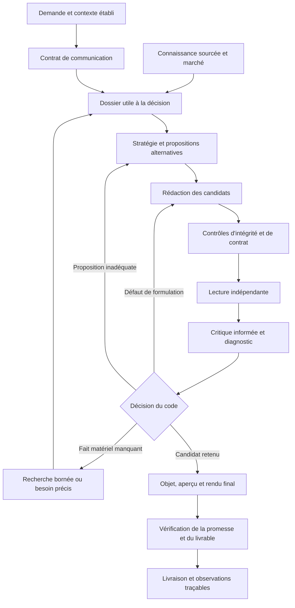

# Plan d'amélioration MarketingOS — qualité de copywriting professionnel

Date : 29 octobre 2026. Statut : proposition d'architecture et plan d'implémentation, sans modification du générateur.

Fondement : [rapport de recherche marketing et psychologie](recherche-marketing-psychologie-email-2026-10-29.md), relu avec les modules actuels de génération, de critique, de sélection et de contrôle. Les chemins cités dans le document sont relatifs au dépôt. Les conclusions d'implémentation ci-dessous sont des propositions à vérifier, pas des effets commerciaux démontrés par les études.

## 1. Direction proposée

**Faire de MarketingOS un système qui conçoit une décision commerciale, l'exprime avec une voix distinctive et vérifie le message effectivement livré.**

La qualité professionnelle ne se réduit ni à l'absence d'erreurs ni à une note élevée d'un lecteur simulé. Pour ce projet, un email de haute qualité doit remplir sept fonctions :

1. Être pertinent pour la relation, la situation et l'objectif réels.
2. Porter une idée utile, spécifique à l'offre et compréhensible sans le brief.
3. Faire désirer une conséquence crédible : résultat, expérience, maîtrise, confort ou découverte selon l'offre.
4. Employer les preuves et conditions qui rendent cette idée défendable.
5. Donner envie d'une action dont l'intérêt et l'engagement sont intelligibles, lorsqu'une action est attendue.
6. Avoir une voix, un rythme et une précision qui évitent l'impression de texte générique.
7. Tenir la même promesse dans l'objet, le pré-en-tête, le corps, le CTA et la destination.

La proposition radicale est de remplacer l'accumulation de consignes universelles par **des contrats de communication contextualisés et un circuit de révision fondé sur la cause du défaut**. Conserver la machine à états, les sources vérifiées, les frontières de confiance et l'observabilité. Une réécriture complète en agents autonomes ajouterait ici du coût et de l'incertitude sans mécanisme de gain établi.

## 2. Diagnostic de départ : ce qui existe réellement

| Existant observé | Limite ou question à traiter | Décision |
|---|---|---|
| `CampaignIntent` distingue déjà les objectifs et relations | La situation du lecteur et le jugement restent souvent centrés sur le clic immédiat | Propager l'intention jusqu'au contrat d'évaluation |
| `EmailBrief` et `ArgumentOption` portent déjà des propositions complètes | La différence entre candidats doit rester commerciale et éditoriale, pas cosmétique | Étendre les alternatives existantes, sans nouvelle équipe d'agents |
| Les champs `next_step_*` décrivent déjà la valeur du prochain pas | Il faut prouver qu'ils modifient la copie et le jugement | Les utiliser comme base du contrat d'action |
| `Critique.failure_mode` distingue `copy`, `argument`, `missing_material` | Le diagnostic doit provoquer une réparation adaptée et bornée | Étendre ce mécanisme, ne pas le recréer |
| Le lecteur et l'inbox utilisent maintenant des scores éditoriaux explicitement non calibrés | Un score éditorial peut encore masquer plusieurs défauts distincts | Mettre les observations et désaccords devant le score |
| Les prompts contiennent de nombreuses corrections de cas passés | Consignes longues, exceptions et formulations universelles peuvent se contredire | Construire des modules courts activés selon le contexte |
| Le writer impose lui aussi la personne pressée et les 400 messages non lus | Le biais est présent en création, pas seulement en évaluation | Corriger simultanément writer, reader, inbox et duel |
| `substantiation.py` vérifie la présence de supports | Présence, pertinence et force de preuve restent des questions différentes | Ajouter une analyse de liaison dans les rôles existants |
| L'objet est optimisé après la lecture du message | Le changement peut modifier l'attente sans nouvelle lecture complète | Garantir une couverture de revue de l'artefact final |
| Les règles de répétition et de longueur sont strictes | Une répétition utile ou une instruction courte peut être rejetée | Distinguer intégrité, contrat et préférence éditoriale |

Ces constats proviennent d'une lecture statique du code de travail, incluant les changements locaux existants. Ils ne constituent pas une mesure de fréquence des défauts en production.

## 3. Architecture cible

Ces blocs désignent des responsabilités, pas autant de nouveaux appels. Le contrat est assemblé en code à partir des données existantes et de l'interprétation déjà produite par le Strategist. Le dossier réutilise la compilation et la recherche actuelles. La critique reste un rôle informé ; le lecteur reste indépendant.

La boucle vers la stratégie réutilise d'abord les alternatives déjà préparées. Une véritable nouvelle stratégie, si proposée ultérieurement, est un recours plafonné et comptabilisé, jamais une boucle libre.

### Trois représentations, avec une seule autorité par information

**Contrat de communication.** Étendre `CampaignIntent` et le contrat existant avec la décision recherchée, le type d'action, les contraintes éditoriales et leur origine. Conserver les champs d'objectif, de relation et de destination existants. Éviter une deuxième copie contradictoire de l'intention.

**Dossier de décision.** Vue de lecture sur les artefacts actuels : contexte établi, hypothèses, proposition, preuves, conditions, objections et action. Réutiliser `decision_context.py`, le dossier de pertinence et les `next_step_*`. Pas de nouvelle base vectorielle ou de graphe externe dans le premier lot.

**Évaluation du livrable.** Observations attachées à une version exacte : offre comprise, action comprise, attente créée, doute matériel, qualité éditoriale et limites de la revue. Une note synthétique éventuelle reste secondaire et non prédictive.

## 4. Chantiers à implémenter

### A. Un contrat de communication qui pilote toute la chaîne — P0

**Changement.** Distinguer l'objectif commercial de l'action immédiate. Une acquisition peut demander une réponse, une visite ou une réservation ; une newsletter peut apporter de la valeur sans action externe.

Types d'action proposés : `reply`, `inspect`, `try`, `book`, `purchase`, `complete_step`, `read_only`. Ce sont des catégories de comportement attendu, pas de nouvelles promesses produit. L'action conserve son libellé réel et ses conditions.

Ajouter ou expliciter :

- relation et faits connus du lecteur, avec origine ;
- décision que le message doit faciliter ;
- action demandée et valeur reçue en échange ;
- niveau de connaissance établi ou inconnu ;
- format éditorial autorisé et contraintes explicites ;
- conditions de déclenchement connues pour un email de séquence.

**Effet attendu.** Un email d'activation est jugé sur l'aide apportée à l'étape ; un email de prospection sur la pertinence de l'examen proposé. Le modèle n'est plus encouragé à inventer une urgence pour obtenir un clic aujourd'hui.

**Implantation.** `intent.py`, `contract.py`, `request.py`, `briefs.py`, `reader.py`, `report.py`, prompts associés et formulaires d'intention.

**Validation.** Une même offre, avec trois relations différentes, doit produire trois tâches éditoriales cohérentes. Une réponse par email ne doit pas être pénalisée parce qu'aucun lien n'est nécessaire. L'absence d'action externe doit être explicitement compatible avec `read_only`.

**Coût.** Aucun nouvel appel nominal ; modification de schémas et compatibilité à gérer.

### B. Une collecte orientée vers la décision et le désir — P1

**Changement.** Mieux exploiter les sources existantes pour répondre à « pourquoi cette offre mérite-t-elle l'attention ? ». Le dossier doit contenir des capacités, mais aussi les usages, les alternatives pertinentes et les conséquences que les sources permettent raisonnablement d'expliquer.

Organiser la matière par question : utilité, fonctionnement, adéquation, confiance, effort, prix, réversibilité et disponibilité. Distinguer : fait produit ; résultat client attribué ; hypothèse de besoin ; interprétation stratégique. Une hypothèse motivante ne devient pas un fait sur le prospect.

Quand une information manque, rechercher la question qui empêche la décision : « la démonstration est-elle accessible sans inscription ? » est plus utile qu'une nouvelle collecte générale sur la marque. Réutiliser le mécanisme existant de récupération de matière officielle, son cache et ses limites. Le writer ne reçoit aucun accès web.

**Effet attendu.** Le texte peut être désirable et précis sans se réfugier dans « découvrez les fonctionnalités documentées ». Il explique la conséquence utile de ce que le produit fait, sans transformer cette conséquence en résultat garanti.

**Implantation.** `knowledge/decision_context.py`, `market/relevance.py`, `market/material_research.py`, compilation et vues de contexte du writer/critic.

**Validation.** Les limites d'une offre suivent toujours sa promesse ; un fait rare mais décisif n'est pas évincé par des arguments génériques ; une capacité devient une explication d'usage intelligible sans chiffre de résultat inventé.

**Coût.** Réutilisation des appels existants ; recherche supplémentaire seulement sur lacune matérielle, avec plafond explicite.

### C. Séparer vérité d'une preuve et utilité d'une preuve — P1

**Changement.** Faire expliciter par le Strategist le lien entre l'affirmation, le support et le doute traité. Le critique vérifie ce lien au lieu de seulement demander davantage de preuve.

Représentation minimale proposée dans le brief : identifiant d'affirmation, identifiants de preuve, nature du lien, conditions à préserver et portée maximale. La nature du lien reste une appréciation sémantique ; la présence des identifiants et la validité des références sont vérifiées en code.

Exemple : « 12 000 clients » peut appuyer l'adoption, mais ne démontre pas la facilité d'installation. Une certification peut appuyer un périmètre de conformité, pas un retour sur investissement.

Revoir prudemment l'interdiction de perdre une preuve pendant une réécriture. Conserver le garde-fou actuel au départ. Une évolution doit permettre de supprimer une preuve redondante si l'affirmation correspondante disparaît ou si un support équivalent est explicitement substitué, sans autoriser le simple jugement « c'est mieux écrit » à effacer l'appui d'une promesse conservée.

**Implantation.** `briefs.py`, `critic.py`, `substantiation.py`, sélection dans `craft.py` et tests d'intégrité d'argument.

**Validation.** Détecter une citation exacte mais non pertinente, une condition omise et un résultat client généralisé ; accepter une simplification qui retire ensemble une affirmation secondaire et son support.

**Coût.** Aucun nouvel appel nominal ; contexte structuré légèrement plus riche. Ne pas prétendre vérifier l'implication logique générale par des expressions régulières.

### D. Des stratégies créatives qui portent de vrais choix — P1

**Changement.** Enrichir les alternatives déjà produites. Chaque candidat choisit une idée, un bénéfice pertinent, une preuve et un mode d'expression cohérents. Il peut convaincre par démonstration, comparaison bornée, cas réel, annonce, instruction, expérience désirée ou réponse à une objection.

Exemple avec la même offre fictive de relecture :

- montrer le fonctionnement sur un document ;
- illustrer un cas client vérifié de coordination ;
- présenter une nouvelle capacité utile aux clients existants.

Ces angles ne sont valides que si leur matière et leur relation sont disponibles. Deux candidats réellement différents suffisent comme point de départ. Ne pas ajouter trois modèles qui reformulent le même argument.

Le cadre « douleur → alternative actuelle → échec → solution » devient un module parmi d'autres. L'absence de douleur prouvée n'empêche pas d'écrire une annonce intéressante ou de susciter un désir pertinent.

**Implantation.** Strategist, `ArgumentOption`, `_bets` et les mécanismes de pivot existants.

**Validation.** La diversité est évaluée au niveau de la proposition et de l'approche ; le candidat reste dans le périmètre demandé. Si un seul angle est défendable, ne pas inventer une seconde proposition pour satisfaire un nombre.

**Coût.** Même nombre de candidats visé ; pas de promesse d'économie avant mesure.

### E. Un véritable travail éditorial et une voix de marque — P1

**Changement.** Faire du writer un rédacteur disposant d'un dossier net, d'exemples de voix et d'une liberté de composition. Remplacer progressivement les longues instructions répétitives par :

1. un socle court : fidélité aux faits, objectif, lecteur, langue ;
2. le contrat de communication ;
3. la proposition sélectionnée et ses preuves ;
4. quelques exemples de voix vérifiés et pertinents ;
5. les modules applicables au message ;
6. les contraintes particulières de ce cas.

Les modules sont assemblés en code : activation, comparaison, annonce, promotion, cas client, etc. Une règle d'intégrité reste toujours présente ; une instruction propre aux intégrations techniques n'encombre pas un email de mode.

Le critique doit relever aussi les défauts qui font la différence entre correct et professionnel : abstraction, phrases prévisibles, rythme monotone, transition forcée, précaution inutile, bénéfice enfoui, répétition sans valeur et voix incompatible avec la marque.

Prévoir dans la critique ce qu'il faut préserver : phrase forte, exemple précis, cadence, mécanisme distinctif. La réécriture doit pouvoir couper et déplacer, au lieu de seulement ajouter des réponses aux objections. Aucun nouveau rôle permanent de « polisseur ».

**Validation.** Un email chaleureux peut rester chaleureux après correction ; un terme technique utile survit ; une tournure originale n'est pas supprimée au seul motif qu'elle diffère d'une moyenne. Évaluer ces qualités par paires et exemples ancrés, sans test universel de « créativité ».

**Coût.** Aucun nouvel appel nominal ; potentiel de réduction des tokens à mesurer. Chaque règle retirée du prompt doit rester couverte par un test, un module conditionnel ou une décision explicite d'abandon.

### F. Refaire la politique des contrôles — P0

**Changement.** Classer chaque règle existante dans une catégorie explicite.

| Catégorie | Exemple | Traitement |
|---|---|---|
| Intégrité vérifiable | Citation introuvable, URL interdite, champ requis absent | Blocage déterministe |
| Contrat explicite | Limite imposée par l'utilisateur, format d'export | Blocage selon ce contrat |
| Heuristique éditoriale | Longueur cible, nombre de paragraphes, répétition | Avis ou préférence contextuelle |
| Jugement sémantique | Preuve hors sujet, promesse ambiguë, ton coercitif | Critique, révision bornée, observation persistée |

Reclasser les termes commerciaux génériques : une garantie documentée ne doit pas être supprimée parce que sa formulation figure dans une liste de spam. Ne pas confondre ce changement avec une désactivation des contrôles contre les garanties inventées.

Autoriser une répétition utile du nom, de la catégorie, d'une condition de prix ou d'une phrase de marque. Traiter les ouvertures recyclées et les paragraphes dupliqués séparément. Aucun seuil de longueur proposé ne doit être présenté comme scientifiquement optimal.

**Implantation.** `gates.py`, `email_copy.py`, `policy.py`, `sequence.py`, writer et renderer.

**Validation.** Corpus de vrais négatifs et faux positifs : garantie autorisée, acronyme, email court utile, newsletter longue structurée, CTA répété vers une même action, répétition nécessaire d'une condition.

**Coût.** Aucun nouvel appel. Éviter qu'une relaxation stylistique modifie par accident l'ordre des veto d'intégrité.

### G. Évaluer une décision comprise, avec une ignorance préservée — P0

**Changement.** Retirer le décor universel de boîte surchargée dans tous les rôles. Utiliser une situation neutre lorsque rien n'est connu. Les scénarios pressé/attentif peuvent servir au banc de robustesse ; ils ne doivent pas devenir des biographies supposées.

Le lecteur reçoit seulement le message, le contexte légitime du destinataire et la relation établie. Il ne voit ni le résultat espéré, ni le brief, ni les preuves cachées.

Observations proposées :

- ce qui est offert, ou l'information apportée ;
- ce que le lecteur comprend devoir faire ;
- ce qu'il s'attend à obtenir ensuite ;
- ce qui rend le message pertinent ou incertain ;
- la première difficulté matérielle de compréhension ;
- le doute principal et la phrase qui le provoque.

Le critique compare ces observations à l'intention. Le duel compare la valeur et la cohérence des messages pour la relation donnée. Un bon message peut aider une décision sans achat immédiat ; la compréhension ne doit pas exiger systématiquement de redécrire toute la catégorie à un client déjà informé.

**Validation.** Tester aussi le lecteur : absence d'invention de prix, de vécu ou de capacité ; refus de combler une lacune avec le brief ; maintien d'un désaccord non résolu dans le rapport. Une simulation n'est jamais déclarée représentative d'un pourcentage de clients.

**Coût.** Même panel au départ. Toute réduction de lecteurs doit être une expérience distincte, après stabilisation du nouvel instrument.

### H. Réviser selon la cause, avec un critère d'arrêt — P1

**Changement.** Étendre le diagnostic déjà existant en distinguant, dans les motifs et transitions, compréhension, formulation, proposition, matière manquante et incohérence de destination.

| Diagnostic | Réparation | Arrêt |
|---|---|---|
| Formulation ou rythme | Révision ciblée, trois priorités maximum | Pas d'amélioration concrète ou budget atteint |
| Proposition inadaptée | Alternative complète déjà préparée | Alternatives défendables épuisées |
| Fait matériel absent | Chercher dans les sources existantes, puis récupération bornée si utile | Fait introuvable : limiter la promesse ou exposer le besoin |
| Action trop engageante | Choisir une action disponible et compatible avec la demande | Aucune action compatible : ne pas inventer une ressource |
| Objet en décalage | Corriger objet/pré-en-tête | Garder le couple déjà cohérent en cas d'échec |

Conserver l'incumbent sur égalité et les emails terminés en cas de défaillance. Une suggestion de recherche par un modèle ne déclenche pas un parcours web illimité : le code applique le budget et le périmètre.

**Validation.** Un manque de prix ne déclenche pas trois réécritures ; une objection stylistique ne déclenche pas un crawl ; une modification cosmétique ne remet pas en cause toute la stratégie.

### I. Vérifier le message final et sa promesse — P1

**Changement.** Versionner l'ensemble objet, pré-en-tête, corps, CTA, destination et rendu. Toute observation de qualité indique exactement quelle version elle a examinée.

L'optimisation des objets reste une étape spécialisée : l'inbox voit seulement ce qu'une boîte affiche. Une revue informée vérifie ensuite que les attentes créées correspondent au corps et à la destination. Elle ne prétend pas prouver le comportement réel d'une page non récupérée.

Stratégie d'implémentation recommandée : réserver la dernière revue informée existante à l'artefact final lorsque le planning le permet. Sinon, au maximum une revue finale courte et groupée par campagne, annoncée dans le forecast. Une revue groupée a un plafond de taille ; au-delà, prévoir et compter les lots. Ne pas annoncer une revue finale sans coût si elle ajoute effectivement un appel.

Le rendu final est aussi contrôlé gratuitement : liens conservés, CTA non dupliqué involontairement, version texte, contenu lisible, conditions non masquées. La source d'une preuve et l'URL du CTA restent des objets distincts.

**Validation.** Changer l'objet après évaluation invalide la couverture sémantique correspondante ; le nouveau couple est vérifié ou l'ancien est conservé. Tester aussi les modifications de pré-en-tête sans modification d'objet.

### J. Concevoir les séquences comme une progression utile — P2

**Changement.** Chaque email a une contribution nouvelle : comprendre, examiner, comparer, résoudre un doute, commencer, reprendre. Le nombre demandé reste respecté ; si la matière ne permet pas une séquence utile de cette taille, le système l'explique au lieu de masquer le remplissage.

Ne pas supposer un clic ou un achat dans les messages suivants. Quand un déclencheur réel est fourni, le conserver. Répéter une condition ou une identité nécessaire est autorisé ; répéter le même argument avec une nouvelle accroche n'est pas un progrès.

Le reviewer de séquence juge l'utilité de chaque position, les contradictions et la cohérence de la promesse. Il n'exige pas une montée artificielle de pression jusqu'au dernier message.

**Validation.** Une séquence d'onboarding reste utile sans activité supposée ; une annonce n'invente pas cinq urgences ; retirer un email purement redondant est diagnostiqué, sans réduire silencieusement le nombre commandé.

### K. Traduire la psychologie en options documentées — P2

**Changement.** Créer un petit registre versionné de tactiques, utilisé par la stratégie. Chaque entrée contient : fonction, contexte possible, prérequis factuels, risque de mauvais usage, niveau de preuve de recherche et exemples de contre-indication.

Exemples : preuve sociale pertinente ; rareté réelle ; diminution d'un risque par une condition existante ; cas narratif vérifié ; personnalisation fondée sur une information légitime ; bénéfice d'usage ou de plaisir.

L'autorité d'une étude marketing ne rejoint jamais l'Evidence Ledger produit. Les résultats de recherche guident le choix d'une forme ; ils n'autorisent aucune statistique ou promesse pour la marque.

**Validation.** Pas de rareté sans fait à jour ; pas de remise inventée ; pas de personnalité déduite du métier. Une tactique peut être absente : aucun quota de leviers psychologiques par email.

**Coût.** Fichier de configuration et modules de prompt ; aucun nouveau rôle.

### L. Un retour produit compréhensible — P2

**Changement.** Présenter l'email final en premier, puis une explication concise : intention comprise, appuis utiles, éventuelle question non résolue. Éviter une interface où l'utilisateur doit interpréter dix notes pour décider si le texte lui convient.

Séparer les contrôles de contenu des prérequis d'envoi. Conserver un accès aux détails, aux sources et aux révisions. Afficher la version du texte réellement relue et la portée de la vérification.

Le statut livré, à revoir ou incomplet découle des états existants et de règles explicites. Un goût du modèle ne devient pas une certification juridique, une garantie de délivrabilité ou un veto indéfini.

## 5. Ordre d'implémentation et lots indépendamment livrables

| Lot | Contenu | Dépendance | Critère de sortie |
|---|---|---|---|
| 0 — Référence | Jeu de cas, sauvegarde des sorties, version des prompts et règles | Aucune | Avant/après comparable et cas de réserve séparés |
| 1 — Bonne tâche | A + G ; cohérence de l'intention dans tous les rôles | Lot 0 | Réponse, activation, lecture et clic distingués ; aucun décor universel |
| 2 — Liberté encadrée | F + début de E | Lot 1 | Faux positifs stylistiques réduits sans régression d'intégrité |
| 3 — Force de l'argument | B + C + D | Lots 1–2 | Proposition spécifique, preuve pertinente, alternative réelle |
| 4 — Finition professionnelle | Fin de E + H + I | Lot 3 | Révision ciblée ; voix préservée ; artefact final couvert |
| 5 — Séquences et produit | J + K + L | Lot 4 | Progression utile et restitution fidèle des limites |

Ordre important : assouplir les règles avant d'avoir corrigé l'évaluation pourrait simplement rendre plus faciles à livrer des textes mal adaptés. Ajouter la psychologie avant de fiabiliser la promesse et la preuve amplifierait des défauts existants.

**Périmètre minimum à forte valeur : lots 0 à 2.** Il corrige ce que le système cherche à produire et ce qu'il pénalise. **Cible complète : lots 3 à 5**, qui renforcent l'argument, le style et la livraison.

L'effort exact dépend des contrats et migrations touchés. Le lot 1 est surtout transversal ; le lot 3 est le plus exigeant sémantiquement ; le lot 4 comporte le principal arbitrage coût/qualité. Éviter de promettre une date avant l'inventaire des dépendances.

## 6. Banc de qualité : prouver autre chose qu'une hausse de note

### Jeu de départ proposé

Préparer 24 briefs contrôlés : six situations de communication, deux niveaux de matière disponible et deux contextes de produit. Inclure explicitement prospection avec réponse, annonce, activation, comparaison, newsletter et reprise d'une action établie. Couvrir du français et de l'anglais, des produits techniques et des offres dont l'intérêt est expérientiel. La taille de 24 est un compromis de travail, pas un seuil statistique.

Séparer 16 cas de développement et 8 cas de réserve avant l'ajustement. Chaque cas comporte des sources autorisées, l'intention, les inconnues à préserver et les erreurs interdites. Les exemples humains existants peuvent servir d'ancrages seulement lorsqu'ils correspondent au brief ; des exemples générés ne deviennent jamais « humains » par renommage.

### Trois mesures séparées

**Intégrité et fonctionnement.** Tests scriptés gratuits : couverture du contrat, absence de promesses non autorisées dans les fixtures, conservation des conditions, transition de diagnostic, limites d'appels et restitution de livrables partiels.

**Qualité éditoriale.** Comparaisons anonymisées ancienne/nouvelle version, même brief, mêmes sources, même budget et modèle fixé. Examiner compréhension, intérêt spécifique, force de l'argument, voix, économie de mots et adéquation du prochain pas. Accepter l'égalité et demander une justification ancrée dans le texte. Alterner les positions ; conserver des contrôles identiques et des variations neutres.

**Robustesse des juges.** Mutations plausibles : preuve vraie devenue hors sujet, promesse élargie, étape artificiellement urgente, voix uniformisée, instruction concrète devenue slogan, objet séduisant mais trompeur. Ajouter des contre-exemples : le texte court correct, la répétition utile, la garantie réellement disponible.

### Critères d'acceptation proposés

- Tous les tests d'intégrité ciblés passent ; aucune nouvelle régression dans la suite requise.
- Aucune baisse acceptée sur les cas critiques de relation, de portée de preuve et de destination.
- Les améliorations éditoriales sont visibles sur les cas de réserve, pas uniquement sur ceux qui ont guidé les prompts.
- Les résultats sont rapportés par famille et avec les nombres bruts ; une moyenne ne masque pas l'échec systématique d'un type d'email.
- Les désaccords entre juges sont conservés ; un résultat serré n'est pas présenté comme une victoire certaine.
- Les appels, tokens, délais et révisions inutiles sont comparés à la référence.

Le banc sans utilisateurs permet d'établir une meilleure exécution des briefs et une préférence éditoriale simulée. Pour revendiquer une qualité comparable à un copywriter professionnel, il faut au minimum une comparaison indépendante sur des briefs identiques avec des références professionnelles pertinentes. Cette validation peut être ponctuelle ; elle ne nécessite pas de télémétrie ni de calibration sur l'opérateur. En son absence, parler d'amélioration éditoriale étayée, pas de supériorité prouvée.

## 7. Budget, compatibilité et maîtrise du changement

### Budget modèle

Conserver initialement le nombre de candidats et la profondeur de lecture actuels. Redistribuer les responsabilités avant d'augmenter les appels. La nouvelle structure de prompts doit être mesurée en tokens ; « aucun nouvel appel » ne signifie pas « aucun surcoût ».

Une recherche complémentaire et une revue finale supplémentaire sont les seules extensions envisagées ici ; chacune doit être bornée, observable et reflétée dans `forecast.py`. Retirer un appel existant exige de vérifier ce qu'il détectait, pas seulement de constater son coût.

Les tests scriptés ne prouvent pas l'amélioration du comportement des modèles. Les évaluations facturées doivent porter sur cette question précise, en sous-ensembles, conformément aux pratiques du dépôt.

### Compatibilité

- Versionner les nouveaux contrats et prompts ; enregistrer la version dans les snapshots de campagne.
- Lire les anciens rapports sans réinterpréter un ancien score comme une nouvelle mesure.
- Prévoir des valeurs inconnues plutôt qu'inventer une relation ou une action lors de la migration.
- Adapter les chemins `planned`, `direct` et l'évaluation d'emails existants ; ne pas laisser un ancien chemin contourner les nouveaux contrats.
- Préserver le contrat distinct des messages LinkedIn et vérifier les modules partagés.
- Introduire les changements lot par lot avec un mécanisme de retour à la version précédente, sans exécution parallèle facturée par défaut.
- Pour tout schéma exposé : mettre à jour les modèles frontend, régénérer le schéma API et vérifier les assertions de contrat.
- Conserver `ModelSession`, le funnel d'événements, les règles de facturation et l'orchestrateur comme adaptateur de persistance.

### Vérifications au moment de l'implémentation

Tests ciblés puis suite backend complète avec fournisseurs scriptés ; lint `app tests` ; contrôles de forecast. Pour les modifications frontend : lint, typecheck et tests prévus par le dépôt, après lecture des instructions locales Next.js. Ne pas lancer de campagne réelle pour vérifier un changement de code.

## 8. Ce qu'il faut volontairement éviter

Ne pas ajouter un agent pour chaque principe psychologique, demander à un modèle de router les étapes, réécrire tous les prompts en une fois, instaurer une note magique de persuasion, ou injecter tout le rapport dans chaque appel.

Ne pas confondre prudence et qualité : un email sans erreur mais sans proposition intéressante reste un échec éditorial. Ne pas confondre originalité et exagération : une phrase vive doit garder la même portée factuelle. Ne pas demander aux sources de prouver une préférence de style ; ne pas demander au style de compenser une offre sans adéquation.

**Premier chantier recommandé : construire le jeu de référence, puis faire suivre la décision demandée depuis l'intention jusqu'au jugement final.** C'est la dépendance qui rend utiles les changements plus ambitieux de stratégie, de voix et de révision.
