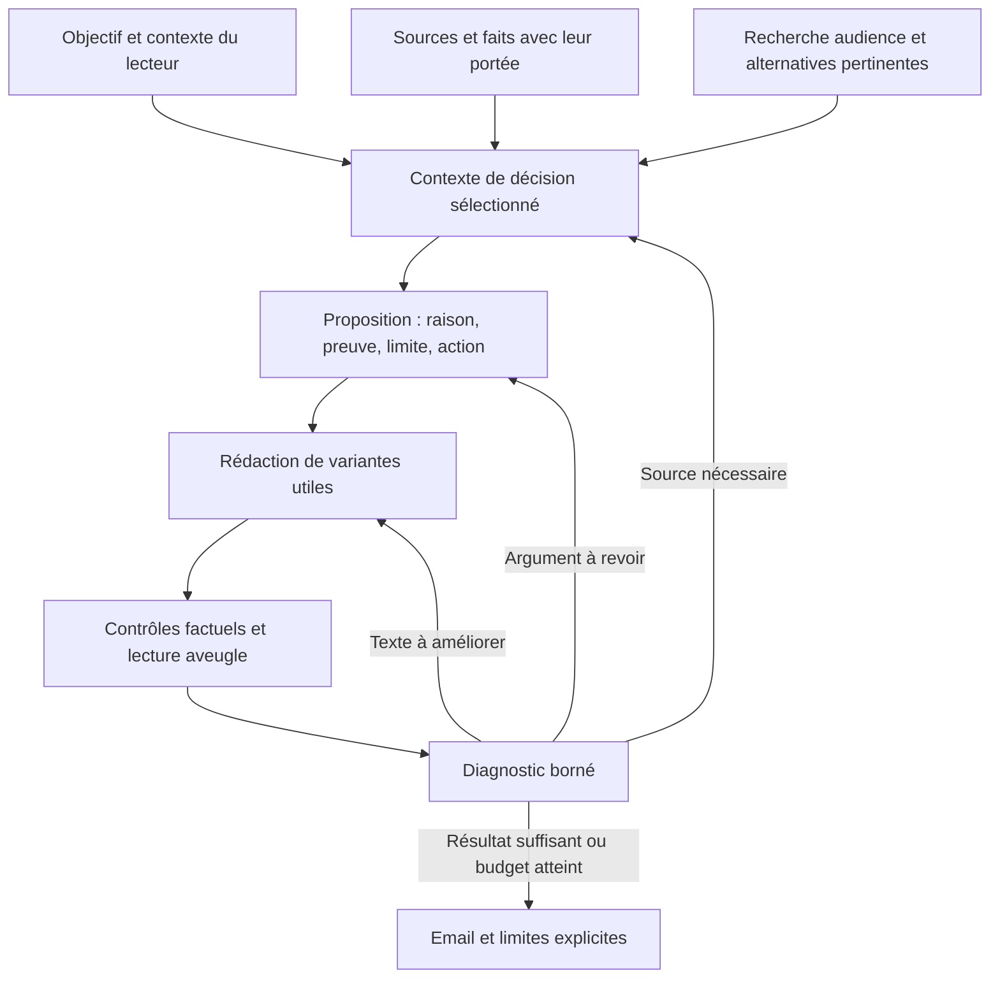

**Proposition pour améliorer la qualité de MarketingOS — 17 octobre 2026**

Cette proposition repose sur le code présent, les sources sauvegardées et le dernier essai Tally. L'audit a été effectué en lecture seule, avec des reproductions déterministes. Aucun nouvel essai de génération n'a été acheté. Ce document propose des changements ; ils ne sont pas implémentés.

Je recommande de faire de la proposition commerciale, liée à l'intention de campagne et à ses preuves, l'objet central du générateur. Le moteur actuel possède déjà des composants utiles : sources conservées, registre de faits, stratégie, variantes d'argument, lecture aveugle, critique, récupération de matériau, budgets et historique. Le problème est leur articulation : un transfert peut perdre une condition, une normalisation changer l'objectif, un indicateur récompense parfois la présence d'un mot au lieu de la preuve.

**1. Ce que l'analyse établit**

| Constat | Conséquence | Preuve locale |
| --- | --- | --- |
| Le bouton Launch Email fabrique une phrase de demande ; son type et les faits du lancement ne sont pas enregistrés séparément. | L'intention d'annoncer, la réalité d'une nouveauté et le niveau de connaissance du lecteur se confondent. | `frontend/src/app/campaigns/new-campaign-dialog.tsx:114`, `:471` ; `runs/20261017T030855006005Z/campaign.json` dans le cas Tally. |
| Le contrat déterministe vérifie surtout forme et nombre. | Un email livré peut respecter « exactement un » tout en s'éloignant du travail demandé. | `backend/app/marketing/contract.py:99`, `:177`. |
| Quand le problème retenu perd son support, le code choisit la première fonctionnalité assignée et utilise sa source comme CTA si l'utilisateur n'a pas fixé d'URL. | La prudence factuelle peut transformer une annonce en lecture de documentation, sans nouvelle décision stratégique. | `backend/app/marketing/strategist.py:283` ; brief final Tally. |
| Les problèmes sont encore rapprochés par égalité/inclusion de texte. | Une paraphrase valable peut perdre son lien lorsqu'il existe plusieurs problèmes candidats. Des identifiants existent déjà dans la recherche et le dossier. | `backend/app/marketing/intelligence.py:417`, `:1068`. |
| L'entrée produit du dossier et son instantané de preuve omettent `Evidence.context` et `document_id`. | Des champs structurés de sujet, conditions, temporalité et limites ne suivent pas ce chemin, même s'ils existent en amont. Certains peuvent néanmoins subsister dans le texte de la citation. | `backend/app/market/relevance.py:129`, `:1145`. |
| Les mêmes informations sont développées dans plusieurs représentations. | Beaucoup de contexte ne signifie pas que la bonne information sera utilisée. Le dossier et le stratège représentent environ 62 % des 335 136 jetons rapportés du dernier essai. | `relevance.py:1145`, `:1205`, `strategist.py:403` ; `calls.json` du run. |
| Le guide contenait un exemple de payload absent du registre compilé. | Un manque d'information apparent peut être un échec d'extraction ou de récupération. La correction récente retrouve la section ; son effet rédactionnel n'a pas été testé avec un modèle. | Journal Tally et `review/retrieved-existing-material.txt`. |
| Le compteur de preuves considère un nom partagé comme un indice suffisant. | Le dernier email Tally compte huit « attributions » par la seule présence de « Tally », sans citer ces clients ou témoignages. Le compteur participe à la sélection et à la conservation des versions. | Reproduction de `substantiation.assess` sur `draft-1-2.json` ; `backend/app/marketing/substantiation.py:234`, `:269`, `:293`. |

La reproduction du dernier point retourne `attributions=8`, avec les entrées E264, E266, E269, E314, E333, E335, E336 et E337 : leur nom partagé avec le texte est uniquement `tally`. Ce défaut de mesure est confirmé. Il ne démontre pas à lui seul que le mauvais draft a remporté le dernier essai.

Deux nuances changent le diagnostic. D'abord, « non-acheteurs » ne signifie pas « prospects froids » : le précédent bilan utilisait une barre d'acquisition froide plus exigeante que le contrat enregistré. Le défaut pertinent reste la faible réponse à « pourquoi cela compte et que faire ensuite ». Ensuite, le dossier possède une piste P4 partiellement étayée et classe E35 en argument principal ; le fallback choisit pourtant E32 d'après l'ordre des preuves assignées. La réponse brute du stratège n'est pas conservée dans ce replay : il est impossible de trancher entre un problème inventé et une paraphrase rejetée.

**2. Architecture cible : une intention et une proposition traçables**

La recherche Market alimente le contexte lorsqu'elle sert la décision. Une annonce ou une activation simple ne devrait pas nécessiter un cycle complet de concurrence, prospection et qualification.

Le changement porte sur les contrats entre modules. FastAPI, SQLite, Next.js, ModelSession, les événements persistés et la machine à états restent des fondations adaptées. Des objets Pydantic et des références versionnées suffisent ; ce besoin ne justifie pas une base graphe ni une orchestration libre d'agents.

**3. Première priorité : conserver l'intention de la campagne**

Étendre les données de campagne avec l'objectif, la relation au lecteur, ce qui est présenté ou annoncé, l'action recherchée et les contraintes explicitement fixées. La demande libre reste conservée. Les champs établis par l'utilisateur, déduits par le modèle et encore inconnus sont distingués.

Le formulaire doit préremplir ces informations et n'exposer que celles qui comptent. Choisir le bouton « lancement » indique une intention ; cela n'établit pas une date de sortie, une nouvelle fonctionnalité ou une urgence. Une déclaration explicite de l'utilisateur sur son lancement constitue du contexte utilisable, avec sa provenance, sans exiger sa publication préalable sur le Web.

Les exigences dépendent du travail demandé : une annonce présente un changement ou une offre et son intérêt ; une activation guide une première action ; une acquisition donne une raison pertinente d'entrer en relation. La douleur, le remplacement d'un outil et la nouveauté concurrentielle ne sont pas obligatoires pour tous les emails.

Les décisions explicites — audience, objectif, URL fixée — ne doivent pas changer silencieusement. Un changement proposé reste visible. Une ambiguïté essentielle peut justifier une question précise ; les cas ordinaires continuent automatiquement avec une hypothèse affichée.

**4. Deuxième priorité : un même contrat de preuve partout**

Faire évoluer `Evidence`, ses rendus et les références de dossier autour d'une représentation commune : identifiant stable, sujet, affirmation, extrait exact et emplacement, source et date pertinente, conditions, limites, type de support et état de vérification. Les résumés citent cette représentation au lieu d'en reconstruire des copies incomplètes.

Séparer clairement « citation retrouvée », « capacité documentée », « résultat attribué à un cas » et « interprétation ». Une relation problème/capacité reste une interprétation révisable ; un identifiant valide ne prouve pas son sens.

Lier aussi l'offre et les destinations d'action à leurs sources. Une URL de documentation prouve l'existence d'un document ; elle n'est pas automatiquement le meilleur CTA. Une page d'essai ne démontre pas que cet essai valide toute la promesse.

La récupération des extraits doit conserver le document, l'URL, le titre de section et les conditions voisines. Un extrait découvert n'élargit pas automatiquement le contrat de revendications. Les faits critiques ajoutés passent par la vérification déjà prévue, puis par une mise à jour explicite de la proposition.

Séparer deux identités de cache : contenu à extraire, et contexte de preuve à utiliser. Une correction de source ou de portée invalide les conclusions dépendantes, sans payer à nouveau toute l'extraction d'un contenu inchangé. Conserver les sources multiples d'un même contenu au lieu de garder seulement la première.

**5. Troisième priorité : choisir une proposition avant de rédiger**

Étendre `ArgumentOption` et `EmailBrief`, plutôt que créer un deuxième système parallèle. Une proposition doit relier :

- le travail demandé et le lecteur visé ;
- la situation ou le déclencheur, avec leurs références lorsqu'ils sont affirmés ;
- la capacité ou l'offre retenue ;
- le bénéfice défendable, ses preuves et ses limites ;
- la raison de choisir cet argument parmi les alternatives ;
- l'action, sa destination et ce que le lecteur pourra réellement y obtenir.

Le stratège propose jusqu'à deux ou trois arguments dans son appel existant. Les alternatives existent déjà : il faut assurer leur intégrité, pas ajouter plusieurs agents de brainstorming. Les références `problem_id`, `evidence_id`, `offer_id` et `action_id` portent les liens ; la prose peut être reformulée librement sans casser ces liens.

Le code contrôle les références, la portée et les contraintes explicites. La qualité du raisonnement est examinée par les rôles existants. Une préférence éditoriale ne devient pas un veto factuel.

Lorsqu'un argument est invalide, essayer une alternative compatible avec la même intention. À défaut, une reprise stratégique bornée réexamine le choix avec la cause précise. Le repli automatique sur la première fonctionnalité et son guide disparaît. Si aucun argument ne répond au besoin avec les informations disponibles, expliquer la limite et conserver le travail utile au lieu de présenter une autre campagne comme équivalente.

Une capacité documentée peut soutenir une explication de mécanisme ou une invitation à essayer. Un témoignage n'est pas exigé pour toute campagne. Les bénéfices plausibles doivent rester proportionnés à ce que le mécanisme permet d'affirmer, sans se transformer en gains mesurés, expériences vécues du destinataire ou résultats garantis.

**6. Quatrième priorité : préparer le contexte pour la décision**

Le contexte envoyé doit être sélectionné autour de l'objectif, des propositions candidates, de l'objection utile et de l'action. Inclure les preuves favorables, les contre-indications et les faits contradictoires pertinents. Les faits assignés et leurs limites sont obligatoires dans ce paquet ; un plafond ne les supprime pas silencieusement.

Commencer avec la recherche lexicale existante, les titres de section et les liens structurés. Préserver une vue compacte des capacités et des inconnues pour ne pas enfermer la sélection dans le premier argument imaginé. Une recherche sémantique supplémentaire ne devient nécessaire que si des cas de synonymes ou de langues différentes démontrent un manque persistant.

La récupération récente de sources intervient après une objection du lecteur. Étendre son usage en amont permettrait de trouver un exemple ou une destination utile avant le premier brouillon. Elle reste locale au corpus d'abord ; une recherche Web ciblée n'est justifiée que par une lacune qui change effectivement la décision.

Les travaux sur les longs contextes montrent que fournir davantage de texte ne garantit pas son utilisation ; ceux sur la récupération contextualisée soulignent la perte de sens des extraits isolés. Cela motive ces essais, sans démontrer un gain pour MarketingOS ou ses modèles actuels. [Lost in the Middle](https://arxiv.org/abs/2307.03172), [Contextual Retrieval — Anthropic](https://www.anthropic.com/engineering/contextual-retrieval).

**7. Cinquième priorité : réparer les critères de sélection**

Un nom de marque commun ou un nombre isolé ne doit plus compter comme une preuve attribuée. Les cas certains reposent sur un passage ou sur une attribution identifiable associée à l'affirmation concernée. Les paraphrases ambiguës restent à examiner, sans être présentées comme des preuves automatiquement utilisées ou supprimées.

Le compteur actuel ne doit pas conserver le pouvoir d'interdire une réécriture sur la seule base de ces correspondances fragiles. Protéger les véritables preuves et leurs conditions est utile ; conserver artificiellement un mot pour préserver un score ne l'est pas.

Conserver le lecteur aveugle pour la compréhension et la réaction au texte. Il reçoit le contexte du destinataire établi indépendamment de l'argument, pas la solution attendue. Le critique reçoit l'intention, la proposition et ses sources pour juger la fidélité et la portée. Les notes sur 10 restent un résumé éditorial ; les décisions comparatives privilégient les versions concrètes et les raisons citées dans leurs textes.

Les duels et leurs contrôles existent déjà : les réutiliser, avec inversion des positions et témoins identiques dans le banc d'évaluation. Les biais documentés de position, de longueur et d'auto-préférence justifient ces contrôles, pas une multiplication automatique des jurés. [Judging LLM-as-a-Judge](https://arxiv.org/abs/2306.05685).

La critique distingue déjà texte, argument et matériau. Faire porter la réparation sur le niveau concerné, avec au plus une reprise amont par défaut et conservation des emails non affectés. Une objection technique n'appelle pas systématiquement un paragraphe supplémentaire : elle doit être nécessaire à la promesse ou à la décision demandée maintenant. Les limites matérielles de la promesse restent visibles.

**8. Effet attendu sur Tally**

Pour l'intention enregistrée, examiner la présentation du produit et la possibilité d'un premier essai. Le corpus contient notamment une offre de création de formulaire, ainsi que la documentation et l'exemple webhook : le guide n'est pas l'unique destination possible.

Si le destinataire évalue effectivement le transport des réponses, une proposition peut rendre explicite l'intérêt de consulter l'exemple de payload et les possibilités documentées d'inspection/reprise des livraisons. Si l'objectif est un premier essai du formulaire, la proposition doit expliquer ce que cet essai permet de juger. Ces voies ne sont pas interchangeables.

Aucune des deux ne doit promettre de résoudre « une automatisation dont personne n'est responsable » sans preuves correspondantes. La possibilité de choisir un autre contexte d'achat peut être proposée ; elle ne doit pas être transformée silencieusement en fait sur l'audience choisie. Un événement de lancement et son intérêt temporel doivent être établis avant d'en faire le centre de l'annonce.

Ce sont des hypothèses de stratégie à comparer, pas des nouveaux emails évalués.

**9. Parcours produit et coût**

Mettre au premier plan trois décisions utilisateur : préparer la campagne, voir la proposition choisie, obtenir l'email. Les vues Audience, Positioning, Competitors et Proof restent les outils permettant d'expliquer ou d'améliorer ces décisions. Le dossier de pertinence devient une synthèse exploitable et réutilisable ; sa génération ne devrait pas être un passage manuel obligatoire pour chaque email.

L'analyse d'un email utilisateur réutilise le même contrat de faits, l'objectif et la revue. La recherche de personnes ou d'entreprises reste une étape de prospection séparée : elle enrichit le contexte réellement observé, sans transformer un profil trouvé en besoin ou intention d'achat démontrés.

| Changement | Impact prévu sur les appels | Travail relatif |
| --- | --- | --- |
| Préserver portée et intention, références par identifiants, corriger les fausses attributions | Aucun appel de génération supplémentaire | Moyen |
| Réutiliser une proposition cohérente et sélectionner le contexte | Appels existants ; réduction de texte à mesurer | Important |
| Choisir une alternative déjà construite | Aucun appel de stratégie supplémentaire | Moyen |
| Replanifier lorsque les alternatives ne suffisent pas | Au plus une reprise stratégique conditionnelle ; remplace des réécritures inutiles, sans garantie d'économie nette | Moyen |
| Chercher une preuve réellement absente | Recherche ponctuelle bornée et annoncée, avec cache ; pas à chaque génération | Moyen |
| Comparer et valider plusieurs cas avec de vrais modèles | Budget d'évaluation distinct, fixé avant chaque série | Moyen |

Le coût complet doit inclure compilation, recherche/dossier, retries, replanification et évaluations. Mesurer séparément un premier passage et une campagne réutilisant les connaissances. Mettre à jour le forecast avant d'activer tout nouveau parcours. Un contexte plus court ne garantit pas à lui seul une baisse de quota ou une meilleure rédaction.

**10. Ordre de réalisation et preuves de réussite**

1. Figer les cas et les sorties actuelles. Ajouter les reproductions des nouvelles défaillances : huit fausses attributions, portée perdue, intention remplacée, paraphrase rejetée et changement dû au seul ordre des preuves. Corriger ces défauts et conserver les entrées/sorties brutes utiles au diagnostic.
2. Introduire le contrat d'intention et les liens explicites de proposition derrière une version de pipeline. Enregistrer plan brut, modifications déterministes, plan effectif et raisons. Garder les historiques lisibles sans leur attribuer rétroactivement des preuves absentes.
3. Remplacer les rendus redondants par le contexte sélectionné. Vérifier la récupération des éléments décisifs, y compris les restrictions. Adapter les réparations à la cause et simplifier les instructions devenues redondantes avec les schémas.
4. Relier l'interface aux nouvelles données, avec des hypothèses et limites compréhensibles. Préparer les migrations, les vérifier sur copie, sauvegarder avant toute migration locale réelle.
5. Comparer trois approches sur les mêmes sources, demandes et plafonds : une génération simple, le pipeline actuel de référence et le pipeline proposé. La version simple est un vrai candidat : si elle produit aussi bien pour moins de coût, certaines étapes doivent devenir optionnelles.

Employer six cas contrastés au départ : annonce SaaS, acquisition B2B, activation, relance e-commerce, offre B2C et offre de service avec peu de preuves externes. Réutiliser les fixtures et références humaines existantes ; signaler les cas synthétiques. Réserver une partie des cas à la validation, sans ajuster les prompts dessus.

Les tests gratuits doivent vérifier notamment l'invariance à l'ordre des faits et aux paraphrases référencées, la distinction absence/contradiction, la conservation des prix et limites, l'absence de faux témoignage, la cohérence objectif/action et la résistance aux faits distracteurs.

Les essais payants évaluent ensuite ce que les tests scriptés ne prouvent pas : pertinence de l'argument, intérêt de l'action, clarté et qualité rédactionnelle. Comparer à l'aveugle, exposer les différences par cas et par critère, vérifier les sources et les rendus, puis rapporter appels, jetons et durée. Ne pas transformer une note éditoriale en taux de conversion.

La proposition sera validée si les défauts reproduits disparaissent, si les campagnes restent fidèles à leur intention et si les nouveaux emails sont préférés pour des raisons identifiables avec seulement des retouches ordinaires, sans régression de portée ni dépassement du budget convenu. Un succès sur Tally seul ne valide pas tous les usages.

Ma priorité est donc une refonte des contrats d'intention, de proposition et de preuve, suivie d'une réduction du contexte et d'une évaluation comparative. La taille de l'infrastructure ou le nombre d'agents ne répondent pas aux défaillances observées.
